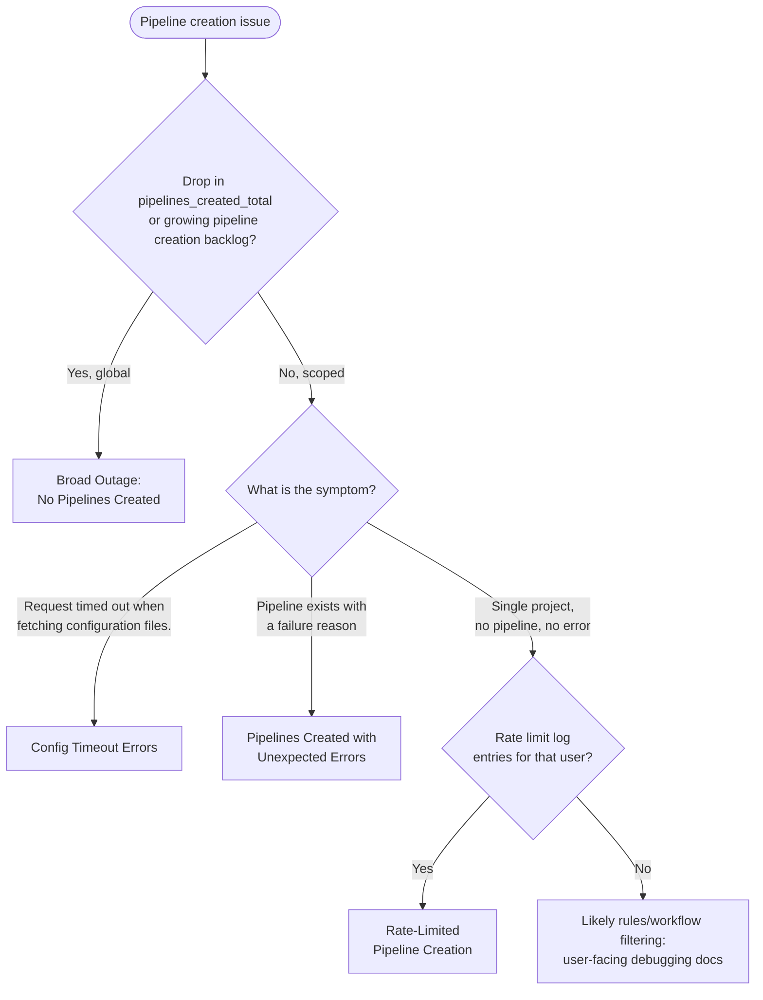

# Pipeline Creation

[[_TOC_]]

## About Pipeline Creation

### Contact Information

- **Group**: Verify:Pipeline Authoring
- **Handbook**: [Pipeline Authoring](https://handbook.gitlab.com/handbook/engineering/devops/verify/pipeline-authoring/)
- **Slack**: [#g_pipeline-authoring](https://gitlab.enterprise.slack.com/archives/C019R5JD44E)

### What is Pipeline Creation?

Pipeline creation is the process of converting a CI/CD configuration (`.gitlab-ci.yml` and included files)
into a persisted pipeline with stages and jobs. It is orchestrated by
[`Ci::CreatePipelineService`](https://gitlab.com/gitlab-org/gitlab/-/blob/master/app/services/ci/create_pipeline_service.rb),
which executes a chain of steps covering validation, config processing, seeding, and persistence.

Pipeline creation is triggered by:

- **Push events**: `CreatePipelineWorker` (Sidekiq queue namespace: `pipeline_creation`, urgency: high)
- **Merge request events**: `MergeRequests::CreatePipelineWorker` (asynchronous, same queue namespace,
  retries 3 times; the MR UI shows a "pipeline creation in progress" state until the worker finishes)
- **API / UI**: `Ci::CreatePipelineService#execute` (synchronous)
- **Scheduled pipelines**: `RunPipelineScheduleWorker`
- **Downstream pipelines**: `Ci::CreateDownstreamPipelineWorker` → `Ci::CreateDownstreamPipelineService`

**Important**: Pipelines can be persisted to the database even with errors (e.g. `config_error`).
The UI shows the failure reason (e.g. "The pipeline failed due to an error on the CI/CD configuration
file.") but the record exists. This is by design.

### Documentation

- [CI/CD Pipelines](https://docs.gitlab.com/ee/ci/pipelines/)
- [CI/CD YAML reference (`include:`)](https://docs.gitlab.com/ee/ci/yaml/#include)
- [CI/CD Components](https://docs.gitlab.com/ee/ci/components/)
- [Debugging CI/CD pipelines](https://docs.gitlab.com/ci/debugging/) (user-facing troubleshooting)

## Troubleshooting

### How You Might Get Here

**From an alert**:

| Signal | Where | Start with |
| --- | --- | --- |
| `CiOrchestrationServicePipelineCreationSidekiq*` apdex/error SLO alerts (S2, pages via PagerDuty, also routed to `#s_verify_alerts`) | [Pipeline Creation Sidekiq SLO alert runbook](../ci-orchestration/alerts/CiOrchestrationServicePipelineCreationSidekiqSLOViolation.md) | [Broad Outage](#broad-outage-no-pipelines-created) |
| Sidekiq apdex/error SLO alerts involving `CreatePipelineWorker` or `MergeRequests::CreatePipelineWorker` | [alerts.gitlab.net (type=sidekiq)](https://alerts.gitlab.net/#/alerts?filter=%7Btype%3D%22sidekiq%22%2C%20tier%3D%22sv%22%7D) | [Broad Outage](#broad-outage-no-pipelines-created) |
| Sidekiq backlog/saturation on the `urgent-ci-pipeline` shard (runs the pipeline creation workers) | [Sidekiq Overview](https://dashboards.gitlab.net/d/sidekiq-main/sidekiq-overview?orgId=1&var-PROMETHEUS_DS=mimir-gitlab-gprd&var-environment=gprd&var-stage=main&var-shard=urgent-ci-pipeline) | [Broad Outage](#broad-outage-no-pipelines-created) |
| Pipeline Authoring error budget burn | [Stage group dashboard](https://dashboards.gitlab.net/d/stage-groups-pipeline_authoring) | [Initial Triage](#initial-triage) |

**From a user report**:

| What the user says | What it usually means | Start with |
| --- | --- | --- |
| "No pipeline appears after I push / on my MR" | Broad outage, queue backlog, or expected behavior (`rules:` filtered all jobs) | [Initial Triage](#initial-triage) |
| Pipeline page / MR widget shows a creation failure message (e.g. "The pipeline failed due to an error on the CI/CD configuration file.") | Pipeline was persisted with a failure reason | [Unexpected Errors](#pipelines-created-with-unexpected-errors) |
| "Request timed out when fetching configuration files." | Config fetch deadline exceeded | [Config Timeout Errors](#config-timeout-errors) |
| "Cannot create a pipeline for this merge request after multiple retries." | `MergeRequests::CreatePipelineWorker` exhausted its retries | [Broad Outage](#broad-outage-no-pipelines-created) |
| MR stuck showing "pipeline creation in progress" | MR pipeline creation request enqueued but not completing | [Broad Outage](#broad-outage-no-pipelines-created) |
| "Pipelines stopped appearing after several pushes in a row" | Creation rate limit for that user or project | [Rate-Limited Creation](#rate-limited-pipeline-creation) |

If a single project has no pipeline and there is no error, first rule out
[rate limiting](#rate-limited-pipeline-creation); otherwise it is most often expected behavior:
`rules:` / `workflow:rules` filtering out all jobs. Point the user to
[Debugging CI/CD pipelines](https://docs.gitlab.com/ci/debugging/) before treating it as an incident.

### Initial Triage



**Determine scope**: Is this global or limited to specific projects/namespaces?
All queries below run in [Grafana Explore](https://dashboards.gitlab.net/explore) with the
`mimir-gitlab-gprd` datasource.

- Check for a drop in the pipeline creation rate:

  ```promql
  sum(rate(pipelines_created_total{environment="gprd"}[5m]))
  ```

- Check the pipeline creation error SLI of the [ci-orchestration service](../ci-orchestration/README.md)
  (normally near 0):

  ```promql
  gitlab_component_errors:ratio_5m{component="pipeline_creation_sidekiq_execution", type="ci-orchestration", environment="gprd"}
  ```

- Check for spikes in any specific failure reason:

  ```promql
  sum by (reason) (rate(gitlab_ci_pipeline_failure_reasons{environment="gprd"}[5m]))
  ```

- Check backlog for the `urgent-ci-pipeline` shard (where pipeline creation workers run) in
  [Sidekiq Overview](https://dashboards.gitlab.net/d/sidekiq-main/sidekiq-overview?orgId=1&var-PROMETHEUS_DS=mimir-gitlab-gprd&var-environment=gprd&var-stage=main&var-shard=urgent-ci-pipeline)

### Broad Outage: No Pipelines Created

**User impact**: Pushes, merge requests, and schedules silently produce no pipelines, or MR widgets hang
in "pipeline creation in progress". This blocks merges and deployments across GitLab.com, so treat it as an
incident immediately.

**Check Sidekiq** (per-worker view: [`CreatePipelineWorker`](https://dashboards.gitlab.net/d/sidekiq-worker-detail/sidekiq3a-worker-detail?orgId=1&var-PROMETHEUS_DS=mimir-gitlab-gprd&var-environment=gprd&var-stage=main&var-worker=CreatePipelineWorker),
[`MergeRequests::CreatePipelineWorker`](https://dashboards.gitlab.net/d/sidekiq-worker-detail/sidekiq3a-worker-detail?orgId=1&var-PROMETHEUS_DS=mimir-gitlab-gprd&var-environment=gprd&var-stage=main&var-worker=MergeRequests::CreatePipelineWorker)):

- Is queue depth growing? Workers may be down or saturated.
- Are workers erroring? Check Kibana (index: [`pubsub-sidekiq-inf-gprd-*`](https://log.gprd.gitlab.net/app/discover)):

```
json.class:"CreatePipelineWorker" AND json.job_status:"fail"
```

**Check Gitaly** ([Gitaly Service Overview](https://dashboards.gitlab.net/d/gitaly-main/gitaly-overview)):

- Config processing fetches `.gitlab-ci.yml` and all includes from Gitaly.
- Look for latency spikes or errors in the `TreeEntry` RPC on `CommitService` (single-file reads such as
  `.gitlab-ci.yml`) and `GetBlobs` on `BlobService` (batched component-include reads). Error rate:
  `grpc_server_handled_total`; duration: the `grpc_server_handling_seconds` histogram, both by `grpc_method`.
- In Kibana (index: [`pubsub-sidekiq-inf-gprd-*`](https://log.gprd.gitlab.net/app/discover)):

```
json.exception.class:("GRPC::DeadlineExceeded" OR "Gitlab::Ci::Config::External::Context::TimeoutError") AND json.class:"CreatePipelineWorker"
```

**Check Database** ([Patroni CI Overview](https://dashboards.gitlab.net/d/patroni-ci-main): CI tables live
on the decomposed `ci` database; [Patroni Marginalia Sampler](https://dashboards.gitlab.net/d/patroni-marginalia-sampler/patroni-marginalia-sampler?orgId=1&var-PROMETHEUS_DS=mimir-gitlab-gprd&var-environment=gprd&var-type=patroni-ci)
to correlate in-flight queries with endpoints):

- Pipeline persistence happens at the end of the chain: the pipeline record is saved, then stages and
  jobs are bulk-inserted in batches, producing a burst of writes.
- Check for connection pool saturation, lock contention, or replication lag.
- In Kibana (index: [`pubsub-sidekiq-inf-gprd-*`](https://log.gprd.gitlab.net/app/discover)):

```
json.exception.class.keyword:ActiveRecord\:\:* AND json.class:"CreatePipelineWorker"
```

**Check recent changes**:

- Feature flag changes: [feature-flag-log](https://gitlab.com/gitlab-com/gl-infra/feature-flag-log/-/issues)
  logs every production flag toggle. Check for recent changes touching CI/pipeline flags, and verify a
  suspect flag's state with `/chatops run feature get <flag>`.
- Deployments: check [#announcements](https://gitlab.enterprise.slack.com/archives/C8PKBH3M5) or run
  `/chatops run auto_deploy status` for a deploy that coincides with the start of the problem.

**Mitigation**: A broad outage is almost always caused by infrastructure (Sidekiq capacity, Gitaly,
database) or a bad deploy/flag change, so the fix belongs to the owning team:

- Suspect flag change → ask the flag owner (named in the feature-flag-log issue) to revert it.
- Suspect deploy → raise it in the incident; rollback is owned by Delivery.
- Infra saturation → escalate to Infrastructure (see [Escalation](#escalation)) with the evidence gathered above.

### Config Timeout Errors

**User impact**: The pipeline is persisted with `config_error` and the user sees
"Request timed out when fetching configuration files." on the pipeline page or MR widget. Retrying often
succeeds, but sustained timeouts block affected projects from running any CI.

**Error**: "Request timed out when fetching configuration files."
**Exception**: `Gitlab::Ci::Config::External::Context::TimeoutError`
**Failure reason**: `config_error`

**Timeout mechanisms**:

| Timeout | Default | Env Var |
| --- | --- | --- |
| Global config deadline | 30s | `GITLAB_CI_CONFIG_FETCH_TIMEOUT_SECONDS` (0-60) |
| Gitaly fetch timeout | 10s | `GITLAB_CI_CONFIG_GITALY_TIMEOUT_SECONDS` (1-60) |
| Remote HTTP open/read timeout | 10s / 30s (retries 3x with backoff) | `GITLAB_CI_CONFIG_HTTP_OPEN_TIMEOUT_SECONDS` / `GITLAB_CI_CONFIG_HTTP_READ_TIMEOUT_SECONDS` |

The `ci_config_fetch_timeout_override` ops flag (see Mitigation) is a separate lever from the env var:
the env var is capped at 60s, while the flag sets a fixed 90s deadline and takes precedence when enabled.

Component includes (`include:component`) are fetched from Gitaly **sequentially**.
Projects with 15-20+ component includes are at higher risk of hitting the 30s deadline.

**Investigation**:

1. Check volume and distribution (index: [`pubsub-sidekiq-inf-gprd-*`](https://log.gprd.gitlab.net/app/discover)):

```
json.exception.class:("Gitlab::Ci::Config::External::Context::TimeoutError" OR "Gitlab::Ci::Config::External::Context::HTTPTimeoutError")
```

Narrow by namespace: add `AND json.meta.root_namespace:"<namespace>"`

2. Trace a failure by correlation ID:

```
json.correlation_id:"<correlation_id>"
```

3. Compare timeline against the [Gitaly Service Overview](https://dashboards.gitlab.net/d/gitaly-main/gitaly-overview).
   Look for `config_file_fetch_component_content` entries.

4. Check project config complexity in [pipeline creation logs](https://log.gprd.gitlab.net/app/r/s/r5Owf).

**Known patterns** (from [RFH#3547](https://gitlab.com/gitlab-com/request-for-help/-/issues/3547)):

- 20+ component includes significantly increase timeout probability
- Component includes use Gitaly even though they look like HTTP URLs
- Errors are often intermittent and succeed on retry
- Gitaly latency spikes correlate directly with timeout spikes

**Mitigation**:

1. **Retry**: intermittent timeouts usually succeed on retry; confirm with the user first.
2. **Raise the deadline for the affected namespace**: the `ci_config_fetch_timeout_override` ops flag
   ([introduced in 18.11](https://gitlab.com/gitlab-org/gitlab/-/issues/594604)) raises the global config
   deadline from 30s to 90s for a root namespace:

   ```
   /chatops run feature set --namespace=<root-namespace> ci_config_fetch_timeout_override true
   ```

   Blast radius: only the targeted namespace, and only lengthens the deadline, so it is safe to apply during
   triage, but flag it to Pipeline Authoring so it gets cleaned up.
3. **Reduce config complexity** (longer term, user action): consolidate component includes; share the
   known patterns above with the affected customer.

If timeouts are sustained and correlate with Gitaly latency, the root cause is Gitaly-side: escalate
with the correlation IDs and dashboard links.

### Pipelines Created with Unexpected Errors

**User impact**: Pipelines exist but immediately fail with a visible error message; users see the
failure reason message (e.g. "The pipeline failed due to an error on the CI/CD configuration file.")
on the pipeline page or MR widget.

Identify which reason is spiking in [Grafana Explore](https://dashboards.gitlab.net/explore)
(datasource: `mimir-gitlab-gprd`):

```promql
sum by (reason) (rate(gitlab_ci_pipeline_failure_reasons{environment="gprd"}[5m]))
```

**Failure reasons reference**:

| Reason | Description |
| --- | --- |
| `config_error` | Invalid YAML, include resolution failure, seed error |
| `external_validation_failure` | External validation service rejected the pipeline |
| `size_limit_exceeded` | Too many jobs in pipeline |
| `job_activity_limit_exceeded` | Too many active jobs for the namespace |
| `deployments_limit_exceeded` | Too many deployments in pipeline |

For `config_error`, check if it is include-related (index: [`pubsub-sidekiq-inf-gprd-*`](https://log.gprd.gitlab.net/app/discover)):

```
json.exception.class.keyword:Gitlab\:\:Ci\:\:Config\:\:External\:\:*
```

For `external_validation_failure`, check the external pipeline validation service health.

**Mitigation**:

- Check whether the spike coincides with a change: recent deployments,
  [feature flag toggles](https://gitlab.com/gitlab-com/gl-infra/feature-flag-log/-/issues), or application
  setting changes (`ci_max_includes`, `ci_max_total_yaml_size_bytes`). Revert the change via its owner.
- Limit-related reasons (`size_limit_exceeded`, `job_activity_limit_exceeded`,
  `deployments_limit_exceeded`) for a single namespace are usually working as intended: the namespace hit
  its plan limits. Confirm before treating as an incident.
- `external_validation_failure` spikes are owned by the validation service, not pipeline creation:
  escalate to Infrastructure.

### Rate-Limited Pipeline Creation

**User impact**: No pipeline is created. Pipeline creation triggered from the API or UI returns
"Too many pipelines created in the last minute. Try again later.", but push and merge request
events create pipelines asynchronously in Sidekiq, so those are dropped silently: the user sees
no pipeline and no error. This affects an individual user or project rather than the instance,
and usually follows several creations in quick succession: retry loops, automation, or a script
pushing repeatedly.

[`Chain::Limit::RateLimit`](https://gitlab.com/gitlab-org/gitlab/-/blob/master/lib/gitlab/ci/pipeline/chain/limit/rate_limit.rb)
enforces two limits, both over a 1-minute window:

| Limit | Scoped to | Configured by |
| --- | --- | --- |
| `pipelines_create` | project + user + sha | `pipeline_limit_per_project_user_sha` application setting |
| `pipelines_created_per_user` | user | `pipeline_limit_per_user` application setting |

Child pipelines, pipeline execution policy pipelines, certain Duo workflow definitions, and
CI lint checks (unless `ci_enforce_ci_lint_rate_limit` is enabled) are excluded.

**Important**: a throttled pipeline is never persisted and no `failure_reason` is set, so it
appears in neither the project's pipeline list nor `gitlab_ci_pipeline_failure_reasons`, and
there is no throttle metric. The logs are the only signal
(index: [`pubsub-application-inf-gprd-*`](https://log.gprd.gitlab.net/app/discover)):

```
json.class:"Gitlab::Ci::Pipeline::Chain::Limit::RateLimit"
```

- `json.throttled:true`: creation was actually blocked
- `json.throttled:false`: logged only; the project has the enforcement override enabled
- `json.namespace_id`, `json.project_id`, `json.subscription_plan` narrow it down

**Mitigation**: first confirm the volume is legitimate. Automation loops are the common cause,
and the limit is usually working as intended. If a customer genuinely needs it lifted, the ops
flag `ci_enforce_throttle_pipelines_creation_override` disables *enforcement* for a project
(the limit is then logged but not blocked):

```
/chatops run feature set --project=<project> ci_enforce_throttle_pipelines_creation_override true
```

Blast radius is the single project, but it removes a protection rather than adding headroom, so
flag it to Pipeline Authoring for cleanup. Changing the limits themselves is an application
setting change owned by Pipeline Authoring, not a triage action.

### Worked Example: Tracing a Config Timeout

A customer reports intermittent "Request timed out when fetching configuration files." on project `X` in
namespace `acme`:

1. **Confirm volume** in Kibana (index [`pubsub-sidekiq-inf-gprd-*`](https://log.gprd.gitlab.net/app/discover), last 7 days):
   `json.exception.class:"Gitlab::Ci::Config::External::Context::TimeoutError" AND json.meta.root_namespace:"acme"`
   → intermittent failures, a few per day, clustering around specific hours.
2. **Pick one failure** and copy its `json.correlation_id`, then search
   `json.correlation_id:"<id>"` across the [`pubsub-sidekiq-*` and `pubsub-rails-*` indexes](https://log.gprd.gitlab.net/app/discover) → the
   `config_file_fetch_component_content` steps show where the 30s deadline was spent.
3. **Overlay the timestamps** on the [Gitaly Service Overview](https://dashboards.gitlab.net/d/gitaly-main/gitaly-overview)
   → if failure clusters line up with Gitaly latency spikes, it matches the RFH#3547 pattern.
4. **Mitigate and hand off**: enable `ci_config_fetch_timeout_override` for `acme` (see above), then
   escalate to Pipeline Authoring with the Kibana search link, one correlation ID, and the Gitaly
   dashboard window.

## Where to Look for Logs

### Dashboards

| Dashboard | URL |
| --- | --- |
| ci-orchestration service overview (pipeline creation SLIs) | [ci-orchestration-main](https://dashboards.gitlab.net/d/ci-orchestration-main/ci-orchestration-overview) |
| Pipeline Observability | [ci-orchestration-pipeline-observability](https://dashboards.gitlab.net/d/ci-orchestration-pipeline-observability) |
| Sidekiq Overview (pre-filtered to the `urgent-ci-pipeline` shard) | [sidekiq-main](https://dashboards.gitlab.net/d/sidekiq-main/sidekiq-overview?orgId=1&var-PROMETHEUS_DS=mimir-gitlab-gprd&var-environment=gprd&var-stage=main&var-shard=urgent-ci-pipeline) |
| Sidekiq Worker Detail (pre-filtered to `CreatePipelineWorker`) | [sidekiq-worker-detail](https://dashboards.gitlab.net/d/sidekiq-worker-detail/sidekiq3a-worker-detail?orgId=1&var-PROMETHEUS_DS=mimir-gitlab-gprd&var-environment=gprd&var-stage=main&var-worker=CreatePipelineWorker) |
| Gitaly Service Overview | [gitaly-main](https://dashboards.gitlab.net/d/gitaly-main/gitaly-overview) |
| Patroni CI Overview | [patroni-ci-main](https://dashboards.gitlab.net/d/patroni-ci-main) |
| Patroni Marginalia Sampler (pre-filtered to `patroni-ci`) | [patroni-marginalia-sampler](https://dashboards.gitlab.net/d/patroni-marginalia-sampler/patroni-marginalia-sampler?orgId=1&var-PROMETHEUS_DS=mimir-gitlab-gprd&var-environment=gprd&var-type=patroni-ci) |
| Pipeline Authoring stage group | [stage-groups-pipeline_authoring](https://dashboards.gitlab.net/d/stage-groups-pipeline_authoring) |
| Pipeline Authoring error budget | [stage-groups-detail-pipeline_authoring](https://dashboards.gitlab.net/d/stage-groups-detail-pipeline_authoring) |
| General Platform Triage | [general-triage](https://dashboards.gitlab.net/d/general-triage/general-platform-triage) |
| Pipeline creation logs (slow) | [Kibana](https://log.gprd.gitlab.net/app/r/s/r5Owf) |
| Sentry | [sentry](https://new-sentry.gitlab.net/organizations/gitlab/issues/) |

### Kibana Index Patterns

| Index | Contains |
| --- | --- |
| [`pubsub-sidekiq-inf-gprd-*`](https://log.gprd.gitlab.net/app/discover) | Sidekiq worker logs, exceptions |
| [`pubsub-rails-inf-gprd-*`](https://log.gprd.gitlab.net/app/discover) | Rails request logs, rate limiting |
| [`pubsub-application-inf-gprd-*`](https://log.gprd.gitlab.net/app/discover) | `application_json.log` from web and Sidekiq (pipeline rate-limit entries) |

### Key Prometheus Metrics

| Metric | What to Watch |
| --- | --- |
| `pipelines_created_total` | Drop = creation issues |
| `gitlab_ci_pipeline_creation_duration_seconds` | Apdex target is 10s (high-urgency worker) |
| `gitlab_ci_pipeline_failure_reasons` | Spike in any reason |
| `gitlab_ci_pipeline_size_builds` | >= 2000 triggers logging |
| `gitlab_ci_active_jobs` | Capacity planning |

The pipeline creation logger emits structured logs when any step exceeds **3 seconds**,
pipeline size >= **2,000 jobs**, or total creation >= **20 seconds**.

## Escalation

### When to Escalate

| Situation | Urgency |
| --- | --- |
| Broad outage: no pipelines being created | Immediate: create an incident |
| Error rate > 5% sustained, or correlated with customer reports of missing pipelines | Escalate now |
| Elevated errors or a failure-reason spike persisting > 1 hour with no improvement | Escalate |
| Single project affected, known pattern | Monitor, no escalation needed |

### Who to Escalate To

| Problem | Team | Channel |
| --- | --- | --- |
| Config processing, includes, components | Pipeline Authoring | [#g_pipeline-authoring](https://gitlab.enterprise.slack.com/archives/C019R5JD44E) |
| Jobs not running after creation | Pipeline Execution | [#g_pipeline-execution](https://gitlab.enterprise.slack.com/archives/CPCJ8CCCX) |
| Gitaly / Database / Sidekiq infra | Infra Tier 2 rotations (Gitaly, Database Operations) | `/inc escalate` in Slack; [#production](https://gitlab.enterprise.slack.com/archives/C101F3796) for coordination |

### Useful Context When Escalating

- Affected namespace(s) and project(s)
- Correlation IDs from failed pipelines
- Timeline and volume of errors
- Whether it correlates with deployments, [feature flag changes](https://gitlab.com/gitlab-com/gl-infra/feature-flag-log/-/issues), or infrastructure events
- Kibana/Grafana links showing the pattern
- Any mitigation already applied (e.g. `ci_config_fetch_timeout_override` enabled for a namespace)
