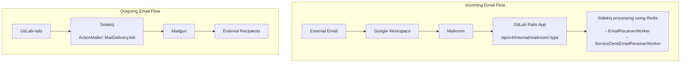

<!-- MARKER: do not edit this section directly. Edit services/service-catalog.yml then run scripts/generate-docs -->

# Mailroom Incoming Mail Service

* [Service Overview](https://dashboards.gitlab.net/d/mailroom-main/mailroom-overview)
* **Alerts**: <https://alerts.gitlab.net/#/alerts?filter=%7Btype%3D%22mailroom%22%2C%20tier%3D%22sv%22%7D>
* **Label**: gitlab-com/gl-infra/production~"Service::Mailroom"

## Logging

* [system](https://log.gprd.gitlab.net/goto/0ce3bf67abafcfc0f81f3d6e7a066912)

<!-- END_MARKER -->

## System Overview

Mailroom is the email processing service that connects GitLab.com's email infrastructure. It acts as a simple email forwarder, retrieving emails from Google Workspace and forwarding them to GitLab's application logic for processing.

If you're looking for sending emails, refer to the [Mailgun operations](../mailgun/mailgun.md) guide.

### Email Infrastructure Architecture



### How Mailroom Works

For GitLab.com:

1. **Mailroom monitors** Google Workspace mailboxes (`incoming@gitlab.com`, `contact-project@incoming.gitlab.com`) via IMAP
1. **Retrieves new emails** and forwards raw email content to GitLab via internal API (`webhook` delivery method)
1. **GitLab application logic** processes the Sidekiq jobs ( `EmailReceiverWorker` or `ServiceDeskEmailReceiverWorker` based on the receiving email address) to parse headers, determine destinations, and create issues/comments ( `EmailReceiver` and handlers in `lib/gitlab/email/handler/` folder).

### Email Features Supported

| Feature | Email Address Pattern | Purpose |
| --- | --- | --- |
| **Reply by Email** | `incoming+[reply-key]@incoming.gitlab.com` | Authenticated users reply to notifications, external users reply to Service Desk emails |
| **Service Desk** | `incoming+[project-key]@incoming.gitlab.com`<br>`contact-project+[project-key]@incoming.gitlab.com` | External users create support tickets |

**Key Point:** Service Desk uses Reply by Email infrastructure for responses, so Mailroom issues affect both features.

## Service Level Indicators (SLIs)

Mailroom monitoring is based on two key SLIs defined in the [metrics catalog](../../metrics-catalog/services/mailroom.jsonnet):

### 1. `emailsProcessed` SLI

* **What it measures**: Rate of emails delivered from IMAP and processed through Sidekiq workers (`EmailReceiverWorker`, `ServiceDeskEmailReceiverWorker`)
* **Alert trigger**: When email processing rate drops significantly or error rate exceeds threshold
* **Note**: Uses Sidekiq metrics since Mailroom itself has limited observability

### 2. `email_receiver` SLI

* **What it measures**: Ratio of emails that fail processing due to application logic errors (excludes auto-generated email errors)
* **Alert trigger**: When error rate exceeds 30% (more lenient threshold due to expected parsing failures)
* **Scope**: Covers email parsing, project matching, and issue/comment creation logic

## Alert-Based Incident Triage

### 📉 `emailsProcessed` SLI Alert: "Email Processing Rate Drop"

**Alerts:**

1. `MailroomServiceEmailsProcessedErrorSLOViolation`
1. `MailroomServiceEmailsProcessedTrafficCessation` (no traffic detected)
1. `MailroomServiceEmailsProcessedTrafficAbsent` (no traffic reported)

**What this means**: Emails are not being ingested from IMAP or Sidekiq jobs are not being created.

**Are there actually new emails to process?**

1. **Send a test email** to `incoming+test@incoming.gitlab.com` or check recent email volume
2. **Check mailbox directly**: SREs can log into `incoming@gitlab.com` and `contact-project@incoming.gitlab.com` to verify unread emails exist
3. **Review email volume trends** on [Mailroom Dashboard](https://dashboards.gitlab.net/d/mailroom-main/mailroom-overview)

**If emails exist but aren't being processed - Infrastructure Problem:**

**Immediate Actions:**

1. **Check Mailroom pod status**
2. **Review Mailroom logs**: Look for IMAP connection errors, authentication failures, or crashes
3. **Verify Google Workspace connectivity**: Check if IMAP access is working
4. **Check recent deployments**: `gitlab-mail_room` gem updates
5. **Mailroom runs but is unable to process emails**: See the [operations section](#operations) below for further actions

### 📧 `email_receiver` SLI Alert: "Email Processing Error Rate High"

**Alerts:**

1. `MailroomServiceEmailReceiverErrorSLOViolation`
1. `MailroomServiceEmailReceiverTrafficCessation` (no traffic detected)
1. `MailroomServiceEmailReceiverTrafficAbsent` (no traffic reported)

**What this means**: Emails are being ingested but failing during application logic processing (parsing, project matching, issue creation).

**Investigation Steps:**

1. **Check recent code deployments**: Look for changes to email processing logic:
   * `EmailReceiverWorker`, `ServiceDeskEmailReceiverWorker`
   * `EmailReceiver` class
   * Handlers in `lib/gitlab/email/handler/`
2. **Review error patterns** in Sidekiq logs for specific failure types
3. **Check for email format changes**: Email providers may have altered headers/formatting

**Checking why a single email wasn't delivered?** Refer to the [Service Desk debugging guide](../service_desk/README.md).

**Escalation**: [Plan: Work Items group](https://handbook.gitlab.com/handbook/product/categories/#work-items-group) (`#g_work_items`) for application logic problems

### 🔍 Mixed Symptoms: Partial Processing Issues

**When both SLIs show problems or symptoms don't clearly match one SLI:**

**Investigation Priority:**

1. **Start with `emailsProcessed`** - if emails aren't being ingested, fix infrastructure first
2. **Then investigate `email_receiver`** - application logic issues only matter if emails are being processed
3. **Check Sidekiq queue health** - backlogged queues can cause both SLIs to alert

## Monitoring & Alerts

* **Primary Dashboard:** [Mailroom Overview](https://dashboards.gitlab.net/d/mailroom-main/mailroom-overview)
* **Alert Channel:** `#alerts_mailroom` - Mailroom processing errors
* **Additional Alerts:** [Mailroom Alerts](https://alerts.gitlab.net/#/alerts?filter=%7Btype%3D%22mailroom%22%2C%20tier%3D%22sv%22%7D)

## Operations

### Infrastructure

The mailroom service runs in the production GKE cluster, in the `gitlab`
namespace.

### Configuration

Mailroom depends on being able to read mail from IMAP and a connection to
redis-sidekiq so that it can queue events on the `email_receiver` queue.

After events are delivered to sidekiq messages are deleted from the IMAP
mailbox.

### Clear e-mail that are piling up

If for some reason Mailroom is unable to process email, an alert will let us
know.  If that alert does not clear, we may need to manually intervene .
Utilize this process to clear the unread count which will force Mailroom to
reattempt to process the email.

* Clear the unread count
From a gitlab-console session:

```
imap = Net::IMAP.new("imap.gmail.com", 993, :ssl => true)
config = Gitlab::MailRoom.config
imap.login("incoming@gitlab.com", config[:password])
imap.select("inbox")
imap.uid_search("UNSEEN")
```

#### Cleanup

```
h = Mail.read_from_string(imap.uid_fetch(<ID>, "RFC822.HEADER")[0].attr["RFC822.HEADER"])
puts "@#{h.date.to_time} from #{h.from.first} to #{h.to.first}.  Subject: #{h.subject}"
```

Note that:

1. `imap.uid_fetch` of the header does a peek that doesn't change the seen
   flags, from which you can, with some visual effort, see the date and decide
   if we want to mark it seen (i.e. ignore it)
1. The to address encodes the namespace/project, so is handy to see. Decide if
   the message too old to want to ingest now (i.e. it would be confusing to
   customers if the message were to suddenly appear on the issue many days or
   weeks after it was sent).  I've been typically considering a couple of days
   as an upper limit, but use your discretion including thinking on the
   from/to/subject e.g. bot responses from 3 weeks ago with a subject of "Error
   fetching data from FOO" are probably irrelevant at more than a very short
   remove, and the message can be ignored.

To mark them seen (ignore them):

```
imap.uid_fetch(<ID>, "RFC822")
```

Fetching the full message marks it as seen.  This will stop mail_room trying to
process it, but not delete it so we are able to review and ingest it later if we
so choose.  Obviously we don't want too many of these, but we can live with even
a few thousand without ill effect.

To do this in a loop asking you what to do for each message:

```
imap.uid_search("UNSEEN").each do |message_id|
  puts "Checking #{message_id}"
  h = Mail.read_from_string(imap.uid_fetch(message_id, "RFC822.HEADER")[0].attr["RFC822.HEADER"])
  puts "@#{h.date.to_time} from #{h.from.first} to #{h.to.first}.  Subject: #{h.subject}"
  puts "Mark this message as seen? (y/N)"
  input = gets.strip
  imap.uid_fetch(message_id, "RFC822") if /[yY]/.match?(input)
end
```

If you want to clear out some obvious ones (e.g. bots) then re-evaluate, feel
free to run this multiple times; it will only show the remaining UNSEEN messages
each run.  Once you've marked as seen all mails you do NOT want to be ingested,
you need to force it to re-ingest.  Stop mail_room on _all_ Mailroom servers for
the environment for slightly more than 10 minutes, then start it on one of them,
wait 30-60 seconds, then start it on the others.  This lets the TTL for the key
expire in Redis to allow it to pick up the messages again.  One could directly
manage Redis by deleting the key, however, this procedure is higher in risk.
Mail ingest is paused for 10 minutes, but SMTP is async and can have delays, so
this is reasonable from a raw technical standpoint.

### Expunging Emails

Currently emails are sent to the trash, but they are not, by default, expunged.
Utilize this process to remove those emails.  This is a lightweight process that
operates at roughly 100 messages per second.  The only time this is needed is if
something happened with Mailroom's ability to expunge emails and the amount of
left over deleted emails is building up over time.

* ssh into a console server for the environment which fired the alert
* grab the password from `gitlab.rb` under attribute
  `gitlab_rails['incoming_email_password']`
* Expunge

```
sudo gitlab-rails c
imap = Net::IMAP.new("imap.gmail.com", 993, :ssl => true)
imap.login("incoming@gitlab.com", "REDACTED")
imap.uid_search("DELETED").length # Informational, shows how many messages are deleted but not expunged
imap.expunge()
```

### Infrastructure accounts

The following emails are used by our various environments for incoming email features:

* `incoming@gitlab.com`
* `contact-project@incoming.gitlab.com`
* `incoming-staging@gitlab.com`
* `contact-project-staging@incoming.gitlab.com`
* `incoming-pre@incoming.gitlab.com`

If the Mailroom pod has trouble accessing these mailboxes for any reason (incorrect credentials, access restrictions, etc.), it will crashloop.

These accounts are administered by IT, so reach out to [#it_help](https://gitlab.enterprise.slack.com/archives/CK4EQH50E) for domain administration or IMAP configuration questions.

<!-- ## Summary -->

<!-- ## Architecture -->

<!-- ## Performance -->

<!-- ## Scalability -->

<!-- ## Availability -->

<!-- ## Durability -->

<!-- ## Security/Compliance -->

<!-- ## Monitoring/Alerting -->

<!-- ## Links to further Documentation -->
