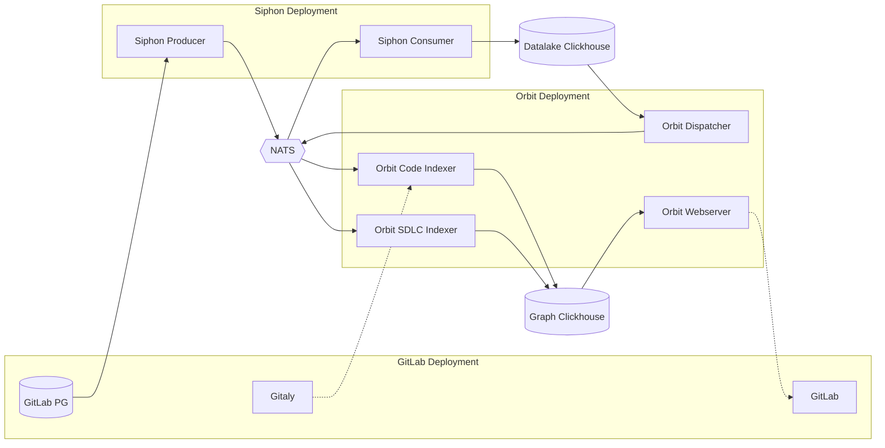
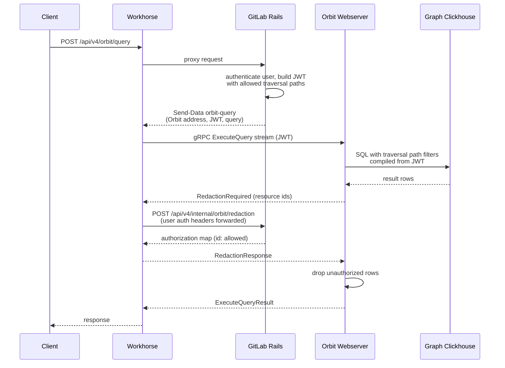
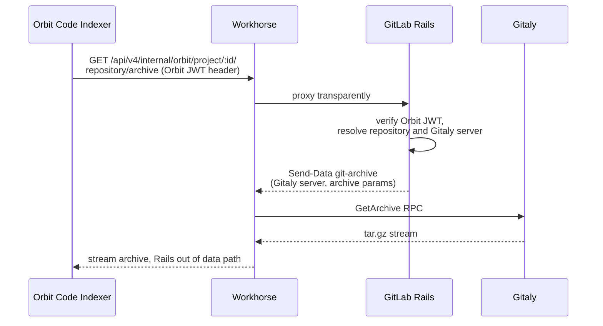

<!-- MARKER: do not edit this section directly. Edit services/service-catalog.yml then run scripts/generate-docs -->

# Orbit Service

* [Service Overview](https://dashboards.gitlab.net/d/orbit-main/orbit3a-overview)
* **Alerts**: <https://alerts.gitlab.net/#/alerts?filter=%7Btype%3D%22orbit%22%2C%20tier%3D%22inf%22%7D>
* **Label**: gitlab-com/gl-infra/production~"Service::Orbit"

## Logging

* [orbit](https://log.gprd.gitlab.net/app/r/s/DhOL5)

<!-- END_MARKER -->

<!--
  WHAT ARE THESE COMMENTS?

  This is a work-in-progress runbook readme for Orbit (aka Knowledge Graph aka GKG) project.
  Comments in sections identify gaps that we should either cover or dismiss.
  Style for this readme is softly terse and easy to read (B1-B2 English).
-->

## Summary

Orbit (GitLab Knowledge Graph, GKG) is a service running alongside GitLab that builds
a live knowledge graph from SDLC data and code repositories.

It powers the Orbit REST API endpoints, Orbit MCP, Orbit Agents, Code Intelligence
and Orbit dashboards.

Orbit is a single Rust binary backed by ClickHouse. It depends on the Siphon service
to replicate GitLab Postgres data into the datalake ClickHouse database and uses
NATS JetStream as the indexing job queue.

* Project: <https://gitlab.com/gitlab-org/orbit/knowledge-graph>
* Owner team: `context_systems`
* Design doc: <https://handbook.gitlab.com/handbook/engineering/architecture/design-documents/orbit/>

The easiest way to access GitLab Orbit is the `glab` CLI tool.

`glab orbit remote` talks to the deployed service this runbook covers. Do not confuse
it with `glab orbit local`, a separate single-binary tool that indexes one local
repository into a DuckDB file on your laptop, with no ClickHouse, NATS or SDLC data.
If a report mentions DuckDB, it is Orbit Local and unrelated to the cluster.

### Quick commands

```shell
# Get services status
glab orbit remote status

# Get graph schema
glab orbit remote schema

# Get graph status for gitlab-org
glab orbit remote graph-status --full-path gitlab-org

# Simple query
glab orbit remote query - <<< '{"query":{"query_type":"traversal","node":{"id":"p","entity":"Project","filters":{"id":{"op":"eq","value":77960826}},"columns":["id","full_path","name"]},"limit":1}}'
```

## Architecture



Dashed arrows are abstracted: Orbit never talks to Gitaly directly and GitLab never
talks to the Orbit webserver directly, both paths go through Workhorse. See the flow
diagrams below.

The diagram omits NATS KV. Orbit keeps two key-value buckets on the same NATS cluster:
`indexing_locks` (the schema migration lock and per-task scheduler cadence locks, so a
single dispatcher replica runs each task) and `orbit_indexing_progress` (per-namespace
and per-entity indexing progress, keyed by traversal path). If the KV reads fail,
`graph-status` reports indexing state as `Unknown` even when queries still work.

Orbit services all share the same binary and the same image running in different modes:

* `indexer`: consumes indexing jobs from NATS and writes graph data to the graph
  Clickhouse. Runs as two pools: SDLC (users, projects, MRs, pipelines, ...) and
  Code (definitions, references, imports). Both pools run the same `--mode indexer`;
  they differ only in the `engine.modules` filter (`sdlc` vs `code`), not a separate mode.
* `webserver`: serves the graph over gRPC (`KnowledgeGraphService`), reads the graph
  Clickhouse with a read-only user.
* `dispatch-indexing` (dispatcher): singleton. Runs graph schema migrations and periodic
  tasks, reads the datalake Clickhouse and Siphon CDC events, publishes indexing jobs
  to NATS JetStream.
* `health-check`: aggregates cluster health (Kubernetes workload readiness plus
  Clickhouse connectivity), backs the `/api/v4/orbit/status` endpoint.

Indexing flow: Siphon CDC replicates GitLab Postgres into the datalake Clickhouse.
The dispatcher publishes indexing jobs to NATS, indexers consume them and write graph
data to the graph Clickhouse.

### Query flow

Clients call `/api/v4/orbit/*` on GitLab. Rails only authenticates the user and answers
redaction callbacks, the result stream is handled by Workhorse to keep load off the
GitLab webservice.



Authorization is layered:

1. Rails authenticates the user, computes the list of group traversal paths the user
   can access (cached 5 minutes, compacted to max 500 entries) and embeds it in a
   short-lived JWT passed to Workhorse in the `orbit-query` Send-Data payload.
2. The Orbit query compiler injects `startsWith(traversal_path, ...)` predicates from
   the JWT into every query, so Clickhouse only returns rows from allowed namespaces.
3. Redaction covers checks not expressible as SQL (confidential issues, SAML, IP
   restrictions): Orbit sends resource ids back over the stream, Workhorse calls the
   Rails internal redaction endpoint with the original user credentials, and Orbit
   drops unauthorized rows before sending the result.

Non-streaming RPCs (schema, tools, status, DSL) are called by Rails over gRPC directly,
without Workhorse.

### Code archive download flow

The Code indexer downloads repository archives and blobs through the GitLab internal
API (`/api/v4/internal/orbit/project/...`), authenticated with an Orbit-signed JWT.
Rails only authorizes the request, the archive bytes are streamed from Gitaly by
Workhorse without loading GitLab.



The same Send-Data mechanism serves blobs (`git-list-blobs`), changed paths
(`git-changed-paths`) and MR diffs (`git-diff`).

Orbit is deployed with [ArgoCD](https://gitlab.com/gitlab-com/gl-infra/argocd/apps/-/tree/main/services/gkg?ref_type=heads)
(service `gkg`) using the [Orbit Helm Chart](https://gitlab.com/gitlab-org/orbit/orbit-helm-charts).
The service has a dedicated GCP project per environment:
`gl-orbit-stg` and `gl-orbit-prd`, with GKE clusters `orbit-stg` and `orbit-prd` in
`us-east1`, namespace `gkg`. All services are stateless Deployments. Both Clickhouse
databases run in ClickHouse Cloud, reached over Private Service Connect. NATS is a
JetStream cluster in the same GKE cluster, namespace `nats`.

### Upstream Dependencies

Dependencies depend on the workload:

#### Indexing SDLC

* Datalake Clickhouse (reads, populated by Siphon services)
* NATS (queue for indexing tasks)
* Graph Clickhouse (writes)

#### Indexing Code

* NATS (queue for indexing tasks)
* Gitaly (serving repository archives and blobs)
* Workhorse (streaming archives and blobs from Gitaly)
* GitLab Webservice (internal Orbit API: project info, authorization)
* Graph Clickhouse (writes)

#### Serving queries

* Gitaly (tools related to code)
* Workhorse (streaming gRPC response from Orbit)
* GitLab Webservice (redaction of data returned from Orbit)
* Graph Clickhouse (reads)

### Downstream Dependencies

* GitLab Webservice (serving `/api/v4/orbit/` API)

### What degrades if X fails

#### Orbit Indexer

* No data can be indexed (depends on SDLC or Code indexer failure)

#### Orbit Webserver

* No Orbit API is available

#### Orbit Dispatcher

* No new indexing jobs are dispatched, in-flight jobs finish, data goes stale

#### Orbit Healthcheck

* Endpoint `/api/v4/orbit/status` no longer available

#### Datalake Clickhouse (or Siphon CDC)

* No data (both Code and SDLC) is indexed, users may get stale data from the Orbit API

#### Graph Clickhouse

* No data can be indexed or queried

#### NATS

* No indexing jobs are dispatched or consumed, all indexing stops
* Indexing locks and progress tracking (NATS KV) are unavailable, graph status reporting is degraded

#### GitLab Webservice (or Workhorse)

* Orbit API is unavailable for users even if Orbit itself is healthy, Rails serves
  `/api/v4/orbit/` and answers redaction callbacks
* No code repositories are indexed, archive downloads go through Rails and Workhorse
* SDLC indexing keeps working, that data comes from Postgres via Siphon CDC
  (unless Postgres itself is down, then there is no new SDLC data to index)

#### Gitaly

* No code repositories are indexed, users may see stale data
* No code blocks can be returned from the Orbit tools, code tools are degraded

## Performance

### SLIs

SLIs are defined in [`metrics-catalog/services/orbit.jsonnet`](../../metrics-catalog/services/orbit.jsonnet)
(service `orbit`, tier `sv`, tenant `analytics-eventsdot`). Service monitoring
thresholds: apdex 0.99, error ratio 0.95.

| SLI | What it measures | Apdex (satisfied / tolerated) |
| --- | --- | --- |
| `gkg_webserver` | gRPC queries to the webserver (`rpc_server_duration_seconds`), errors are non-OK gRPC status codes | 5s / 10s |
| `gkg_indexer_sdlc` | SDLC ETL handlers (`entity.*`) consuming NATS messages (`gkg_etl_handler_duration_seconds`) | 2.5s / 5s |
| `gkg_indexer_code` | Code indexing tasks (`code_indexing_task` handler) | 10s / 30s, apdex target lowered to 0.9 |
| `gkg_dispatcher` | Scheduler task runs (`gkg_scheduler_task_runs_total`), error rate on `outcome="error"` | no apdex |
| `nats_server` | NATS message flow, errors are slow consumers | no apdex |
| `nats_jetstream` | JetStream message flow, errors are redeliveries | no apdex |

Normal query latency is 2-5s with tolerable latency of 10s, matching the
`gkg_webserver` apdex thresholds.

<!-- Gaps (SLIs are work in progress):
     - All SLIs are userImpacting: false and only gkg_webserver has
       serviceAggregation: true; revisit once the Orbit API is GA.
     - No end-to-end SLI for the query path: gkg_webserver only sees the gRPC leg,
       the Rails /api/v4/orbit/* and Workhorse legs are not measured.
     - nats_server / nats_jetstream have no featureCategory (TODO in the catalog).
     - ClickHouse Cloud is not covered by any SLI or saturation signal even though
       it dominates query performance.
     - Leading vs lagging indicators not documented yet. Candidates: leading are
       NATS redeliveries, dispatcher task errors; lagging are webserver apdex and
       indexer error rates. -->

### What dominates performance

During normal day-to-day operation performance is dominated strictly by Clickhouse
compute and IO. High query rates, especially of heavier queries, may increase latency
or make the service unavailable. The graph Clickhouse is shared between indexer writes
and webserver reads, so heavy indexing bursts can also degrade query latency.

Code indexing is CPU bound (parsing) and needs memory and ephemeral disk for repository
archives. SDLC indexing handlers are light, their throughput is bound by Clickhouse
insert latency and NATS consumer fetch rate rather than pod resources.

The dispatcher is slim and a singleton, its scale does not affect system performance.
NATS is only used as a message broker and its scale does not affect system performance,
with one exception: JetStream persists streams to disk, so lagging consumers accumulate
disk usage (tracked by the `nats_disk_space` saturation signal).

Scaling knobs for all of the above are covered in [Scalability](#scalability).

## Scalability

There is no autoscaling of Orbit workloads, all scaling is manual. Replica counts and
resource limits are set in the per-environment values files of the
[ArgoCD](https://gitlab.com/gitlab-com/gl-infra/argocd/apps/-/tree/main/services/gkg?ref_type=heads)
`gkg` service. No HorizontalPodAutoscaler exists for any Orbit workload (confirmed
live: `kubectl -n gkg get hpa` is empty).

### Workloads

Five Deployments run in namespace `gkg`: `gkg-webserver`, `gkg-indexer-sdlc`,
`gkg-indexer-code`, `gkg-dispatcher` and `gkg-health-check`. SDLC and Code are two pools of
the indexer, split by module filter; only the Code pool reserves ephemeral storage for
repository archives. The dispatcher uses the `Recreate` strategy, all other workloads use
`RollingUpdate`.

Replica counts and resource limits are set per environment in the ArgoCD `gkg` values
files (`services/gkg/values.yaml` and `env/<env>/values.yaml`). Read them there, or check
what is running with the [status commands](#status-commands-read-only) in Troubleshooting,
rather than copying numbers into this runbook.

### Indexers

Indexers scale horizontally with more replicas. An indexer can process both SDLC and
code data, however they are split into two separate pools with module filters to handle
the workloads separately. Vertically indexers may get more CPU, RAM or ephemeral disk
space allocated (the code pool downloads repository archives into an `emptyDir`).

Saturation signatures and what they mean:

* High CPU throttling: more CPU should be added.
* OOM kills: there are namespaces or code repositories that the indexer cannot handle
  within its memory limit.
* Evictions for exceeding ephemeral storage: there is a large repository that the
  indexer cannot download, raise `tmpSizeLimit` and the ephemeral-storage limits.

Ephemeral storage applies only to indexers (the Code pool unpacks archives into the
`tmp` emptyDir). `tmpSizeLimit` caps that emptyDir and must stay below the pod
ephemeral-storage limit, or the kubelet evicts the pod before the disk fills. The Code
pool sets both; the SDLC pool has no ephemeral-storage limit. To handle a larger
repository raise `tmpSizeLimit` and the ephemeral-storage limit together. The values are
in the ArgoCD `gkg` values files.

Horizontal scaling of indexers is capped by the dedicated `gkg-pool` GKE node pool, its
autoscaling bounds are set in
[config-mgmt](https://gitlab.com/gitlab-com/gl-infra/config-mgmt) terraform
(`modules/orbit-environment/gke.tf`, per-env values in `environments/orbit-prd`). The pool
is tainted `workload=gkg:NO_SCHEDULE` so only Orbit pods land there. When indexers cannot
scale out further, raise `gkg_pool_max_nodes`; pods beyond the node budget stay `Pending`.
NATS runs on its own node pool.

### Webserver

Webservers may scale both vertically and horizontally, however they are bottlenecked
by the Clickhouse capacity to execute queries, so their scale won't affect anything.
The rare exception is webserver OOM, which means some query is not memory optimized
on the application level, scaling memory helps as a stopgap.

### Dispatcher

Singleton with hardcoded 1 replica (`Recreate` deployment strategy), cannot scale
horizontally. Vertically it may get more memory in case of OOMs caused by unoptimized
query execution.

### Clickhouse

Both databases run in ClickHouse Cloud and are scaled there, not via ArgoCD. The
production graph service (`orbit-production-us-east1`) is provisioned in
[config-mgmt](https://gitlab.com/gitlab-com/gl-infra/config-mgmt) terraform
(`environments/orbit-prd/clickhouse-cloud.tf`) with vertical autoscaling between a min and
max replica memory and `idle_scaling` enabled. Adding replicas improves concurrent query
throughput, more replica memory helps single heavy queries; the current replica and memory
bounds are in that terraform. The staging graph ClickHouse is not provisioned there (it
lives in the `gstg` state), and staging shares one ClickHouse service for both datalake
and graph.

### NATS

JetStream cluster scaled separately (ArgoCD service `nats`). It is a multi-replica
StatefulSet on its own node pool, file-backed (streams persisted to disk). The saturation
resource is JetStream disk (`nats_disk_space` signal), growing usage means consumers are
lagging, scale indexers rather than NATS.

<!-- Gaps:
     - No concrete scale-up rules yet: at what saturation threshold do we add how many
       replicas? Needs operational experience to fill in.
     - No HPA in the helm chart, decide if indexer pools should get one.
     - No Tamland capacity planning for orbit (-> L5), nothing references orbit in
       capacity planning configs. -->

## Availability

Orbit runs in a single region, `us-east1`, one regional GKE cluster per environment
(`orbit-stg`, `orbit-prd`). There is no multi-region setup.

All Orbit workloads are stateless Deployments. Webserver, indexers and healthcheck run
with multiple replicas and PodDisruptionBudgets. The dispatcher is the only singleton
(see [Scalability](#scalability) for workload details).

PodDisruptionBudgets keep capacity up during node drains and rolling restarts: the
webserver and health-check use a `minAvailable` budget, the indexer pools use a
`maxUnavailable` budget. The dispatcher has no PDB on purpose: it is a singleton, so a PDB
would block node drains. A PDB is skipped automatically when a workload has fewer than 2
replicas. The thresholds are in the ArgoCD `gkg` values.

Failover behavior:

* Webserver pod death: remaining replicas keep serving behind the internal load
  balancer, Workhorse replaces broken gRPC connections from its connection cache.
  No user impact while at least one replica is up.
* Indexer pod death: NATS JetStream redelivers unacknowledged jobs to other replicas,
  no data loss, only indexing delay.
* Dispatcher death (or rollout, `Recreate` means a short gap on every deploy): no new
  jobs are dispatched until the replacement pod is up. No user-visible impact, data
  freshness lags.
* Graph ClickHouse runs in ClickHouse Cloud with `idle_scaling` enabled, so the first
  queries after an idle period can be slow while replicas wake up.
* NATS is a multi-replica JetStream cluster (see the gaps note below on stream
  replication factor).

Hard limits that cap availability: the `gkg-pool` node pool autoscaling maximum,
ClickHouse Cloud max replica memory and the per-user `orbit_query` rate limit in Rails.

<!-- Gaps (need operational confirmation, not fillable from config):
     - JetStream per-stream replication factor (R1 vs R3) is app-set; cluster is
       R3-capable but the deployed factor must be read with `nats stream info`.
     - ClickHouse Cloud multi-AZ guarantees taken on faith from the vendor; document
       the SLA once known.
     - Failover has not been game-dayed; the dispatcher gap on deploys and webserver
       LB drain behavior are from config, not from observed incidents. -->

## Durability

All Orbit state lives outside the cluster pods:

* Graph data: graph ClickHouse in ClickHouse Cloud. ClickHouse Cloud takes provider-side
  snapshots, but Orbit does not rely on them. The graph is derived data and all GitLab
  data is reindexable in under 2 hours, so a rebuild is cheaper than a restore.
* Datalake: owned by the Siphon platform (`gitlab_clickhouse_main_production`), its
  durability and backups are outside Orbit's scope.
* Indexing queue: NATS JetStream, backed up by the Velero schedule `velero-nats-backup`
  in both staging and production.

GitLab Postgres plus the repositories remain the source of truth: SDLC data is
re-indexed from the datalake and code from repositories. To rebuild the whole graph,
either:

1. Drain all indexers and the dispatcher, then drop all tables from the graph database
   (`orbit-production-us-east1`). Indexing restarts from empty.
2. Bump `SCHEMA_VERSION` in the Orbit codebase, cut a release and roll the new image
   out via ArgoCD. A schema version bump triggers full reindexing into new
   version-prefixed tables.

The step-by-step rebuild procedures are in [Common Operations](#common-operations).

<!-- Gap: datalake backup policy unknown (owned by Siphon platform), confirm with that
     team. The graph rebuild paths still need a dry run in staging to capture the exact
     drain and DROP commands. -->

## Security/Compliance

Secrets live in Vault and are synced into the cluster by External Secrets Operator
(SecretStore role `gkg`):

* ClickHouse passwords (datalake reader, graph writer, graph read-only) under
  `<env>/gkg/clickhouse-cloud`.
* The GitLab JWT shared key under `shared/knowledge-graph/<env>/jwt`, used to sign and
  verify JWTs in both directions (Rails to Orbit queries, Orbit indexer to Rails
  internal API).
* A registry image pull token.

Secret versions are pinned in the ArgoCD values (`refreshInterval: 0`), rotation means
writing a new version to Vault and bumping the pinned version in the values file. The
image pull token is the exception, it refreshes hourly.

Network posture:

* ClickHouse Cloud has its public listener closed, Private Service Connect is the only
  ingress path.
* The Orbit webserver is exposed only through a GCP internal load balancer, gRPC is
  TLS with cert-manager issued certificates.
* NATS connections use mTLS with cert-manager issued client certificates.
* Orbit reaches GitLab over Private Service Connect. Requests use the public URL
  (`https://gitlab.com:11443` in production), so TLS validates against the real public
  `gitlab.com` certificate chain, no self-signed or custom CA. Because PSC routes the
  traffic privately rather than over the public DNS record, the client overrides DNS
  for the request host: it resolves the internal gateway hostname
  (`internal-gateway.gprd.gke.gitlab.net`) to its PSC address and pins the `gitlab.com`
  host to that IP, while keeping `gitlab.com` as the TLS server name. Set via
  `gitlab.baseUrl` and `gitlab.resolveHost` in the ArgoCD values.

Every gRPC request requires a short-lived (5 minutes) HS256 JWT. User queries are
additionally constrained by the three authorization layers described in
[Query flow](#query-flow), so query results are always scoped and redacted per user.

Data sensitivity: the graph ClickHouse stores SDLC metadata and code symbols
(definitions, references, file paths) of all knowledge-graph-enabled namespaces,
including private projects. The datalake contains replicated GitLab Postgres data and
should be treated with the same care as the GitLab Postgres database itself.

### SRE access

Access is granted through tickets and Vault, not by direct grants on the cluster.

* GCP projects (`gl-orbit-stg`, `gl-orbit-prd`): request via an issue in
  `gl-security/corp/issue-tracker` using the GCP project template, listing who needs it.
* GKE clusters (`orbit-stg`, `orbit-prd`): anyone with read/write access to the GCP
  projects can load a kubectl context with `gcloud`, for example
  `gcloud container clusters get-credentials orbit-prd --region us-east1 --project gl-orbit-prd`.
  There is no separate cluster grant.
* ArgoCD: access is requested through Lumos. Access to a specific service (the `gkg`
  service) is granted by adding the user in the
  [argocd config values](https://gitlab.com/gitlab-com/gl-infra/argocd/config/-/blob/main/apps/argocd/values.yaml#L504).
* ClickHouse Cloud console: org RBAC over SAML. Roles are Org Admin, Service Admin,
  Service Read Only and Billing. For investigation request Service Read Only, not admin.
  The `gkg_writer` / `gkg_reader` / `gkg_siphon_reader` database users are created manually
  by developers with admin access to the databases; there is a plan to manage them with the
  Terraform ClickHouse dbops provider.

### Secret rotation

Secrets are pinned to a Vault version in the ArgoCD values (`refreshInterval: 0`), so
rotation is a two-step change: write a new Vault version, then bump the pinned version
on every consumer.

The GitLab JWT shared key is a single symmetric HS256 key at Vault path
`k8s/shared/knowledge-graph/<env>/jwt`, read by both Rails and Orbit:

```shell
vault kv put -mount=k8s shared/knowledge-graph/<env>/jwt key="$(openssl rand -base64 32)"
```

Then bump the ExternalSecret `version` (for example `"1"` to `"2"`) on both sides and
redeploy: the Orbit side in the `gkg` vault-secrets values, the Rails side in the
`gitlab-knowledge-graph-jwt-v1` ExternalSecret. Neither GitLab nor Orbit can hold two key
versions at once, so there is no overlap window: during a rotation one side is always on
the old key and the other on the new, and JWT verification fails until both match. A
rotation therefore needs a short Orbit downtime. Roll both sides as close together as
possible in a low-traffic window.

ClickHouse passwords (`gkg_writer`, `gkg_reader`, `gkg_siphon_reader`) live in Vault
`orbit-<env>/gkg/clickhouse-cloud`: update the password in ClickHouse Cloud, write the new
value to Vault, bump the pinned version. The image pull token is the exception, it
refreshes hourly and needs no manual rotation.

<!-- Gaps:
     - ClickHouse password rotation has no agreed schedule, only the mechanism above.
     - readiness_review is empty in the service catalog; no compliance review linked. -->

## Monitoring/Alerting

Primary dashboard: [Orbit Overview](https://dashboards.gitlab.net/d/orbit-main/orbit3a-overview?orgId=1&from=now-6h%2Fm&to=now%2Fm&timezone=utc&var-PROMETHEUS_DS=mimir-analytics-eventsdot&var-environment=orbit-prd&var-stage=main).
This is the generated service overview (apdex, error rate, request rate per SLI),
defined in [`dashboards/orbit/main.dashboard.jsonnet`](../../dashboards/orbit/main.dashboard.jsonnet)
and built from the SLIs in the metrics catalog.

The six component dashboards (overview, gkg-webserver, gkg-indexer, nats, siphon,
all-metrics) live in the [orbit Grafana folder](https://dashboards.gitlab.net/dashboards/f/orbit/orbit).
Their jsonnet source of truth is the
[knowledge-graph repo](https://gitlab.com/gitlab-org/orbit/knowledge-graph/-/tree/main/dashboards/orbit);
this repo carries the generated JSON in [`dashboards/orbit/`](../../dashboards/orbit/)
(see its README for the refresh workflow). The upload pipeline prefixes dashboard UIDs
with the folder name, so `orbit-gkg-indexer.dashboard.json` is served under UID
`orbit-orbit-gkg-indexer`.

Logs: [Kibana](https://log.gprd.gitlab.net/app/r/s/DhOL5). Orbit emits structured logs
through labkit-rs to stdout, shipped to the `orbit` index.


## Troubleshooting

### Order of checks

Work top-down: confirm whether the failure is in the user-facing path, in Orbit, or in a
backend.

1. Check from outside. `glab orbit remote status` returns health and version. If `status`
   and `schema` work but `glab orbit remote query` fails, the problem is in the query path
   (webserver or ClickHouse), not the whole service.
2. Check the dashboard. Open the [Orbit Overview](https://dashboards.gitlab.net/d/orbit-main/orbit3a-overview?orgId=1&var-environment=orbit-prd)
   for apdex, error rate and request rate per SLI.
3. Check pods (see status commands below). A Tokio panic does not crash the pod, so a
   broken webserver can still show `Running`. Always test a real query, not just pod status.
4. Read logs in [Kibana](https://log.gprd.gitlab.net/app/r/s/DhOL5) (`orbit` index) or with
   `kubectl ... -n gkg logs <pod>`.
5. Suspect ClickHouse for slow queries. Performance is dominated by ClickHouse compute and
   IO, and a heavy indexing burst can degrade query latency on the shared graph ClickHouse
   (see [What dominates performance](#what-dominates-performance)).
6. Map the symptom to a dependency with [What degrades if X fails](#what-degrades-if-x-fails).

### Status commands (read-only)

```shell
# Workload health and current deployed image tag (swap context for staging)
kubectl --context gke_gl-orbit-prd_us-east1_orbit-prd -n gkg get deploy,pod -o wide

# Disruption budgets and (absence of) autoscalers
kubectl --context gke_gl-orbit-prd_us-east1_orbit-prd -n gkg get pdb,hpa

# NATS JetStream cluster and queue storage
kubectl --context gke_gl-orbit-prd_us-east1_orbit-prd -n nats get statefulset,pod,pvc

# Recent restarts and OOM (indexers are the usual suspects)
kubectl --context gke_gl-orbit-prd_us-east1_orbit-prd -n gkg get pod \
  --sort-by=.status.containerStatuses[0].restartCount
```

Staging context is `gke_gl-orbit-stg_us-east1_orbit-stg`. Orbit pods are in namespace
`gkg`, NATS in `nats`, Siphon CDC in `siphon`. `glab orbit remote` exit codes help triage:
`2` endpoint 404 (feature flag off), `3` 401 not authenticated, `4` 403 access denied,
`5` 429 rate limited. Access to the projects, clusters and ClickHouse console is described
under [SRE access](#sre-access).

### Common signatures

| Signature | Likely cause | First action |
| --- | --- | --- |
| All `query` calls return HTTP 502 after ~15s, but `status` and `schema` work. Webserver logs panic at `gkg-analytics/src/context.rs`, then repeat `LazyLock instance has previously been poisoned`. Pods stay `Running`. | A new image is missing an analytics config file, the analytics `LazyLock` poisons on the first query and breaks all queries. Seen on 0.64.0. | Roll back the image tag (see below). |
| Code indexing fails at the ClickHouse write with `Column '_deleted' is not presented in input data ... (THERE_IS_NO_COLUMN)`. SDLC indexing still works. | Code bug, not config: the code indexer builds Arrow batches without `_deleted`. | No infra fix. Report to the `context_systems` team. |
| Some queries fail with `Code: 159 ... Timeout exceeded ... (TIMEOUT_EXCEEDED)`. | A heavy query hits the ClickHouse 30s execution timeout. | Check ClickHouse load and query weight, not the pods. |
| `get_graph_status` logs `KV bucket ... not registered`. | NATS KV bucket not created at startup. | Cosmetic, graph-status still returns data. Do not roll back for this alone. |
| Dispatcher stuck at readiness 503 right after a deploy. | A schema migration is still running, or the migration lock is held. | Wait for migration, then check dispatcher logs. |
| An indexer or dispatcher fails to start after a stream, consumer or subject config change. | JetStream does not apply config changes to an existing stream or KV bucket in place. | Delete the problematic stream or KV bucket, then restart the pod so Orbit recreates it with the new config. |
| `query` returns HTTP 502 from Rails for one user while others work. Quota check logs show `quota check failed: required claim fields missing`. | The user has several paid Orbit-enabled namespaces and no default (billable) namespace, so Rails mints a JWT without `root_namespace_id` and the quota check fails before reaching CustomersDot. | Set the user's Billable Orbit namespace in their GitLab user preferences. A clearer error message is a known gap. |

### Recent changes and rollback

A deploy is a commit to [argocd-apps](https://gitlab.com/gitlab-com/gl-infra/argocd/apps)
under `services/gkg`. The current image tag is pinned in `env/orbit-prd/values.yaml`
(`image.tag`) and the chart version in `env/orbit-prd/app.yaml`; version bumps arrive as
Renovate MRs. Confirm what is running and when it rolled out:

```shell
kubectl --context gke_gl-orbit-prd_us-east1_orbit-prd -n gkg get rs \
  -o custom-columns=NAME:.metadata.name,IMAGE:.spec.template.spec.containers[0].image,AGE:.metadata.creationTimestamp
```

A fresh ReplicaSet whose age lines up with the incident points at a bad deploy. To roll
back, open an MR in argocd-apps setting `image.tag` back to the last good tag and merge it;
ArgoCD syncs and replaces the pods. Do not roll back by editing the live Deployment with
`kubectl`, ArgoCD syncs it straight back. See [Service Changes](#service-changes).

A rollback to a release with a lower `SCHEMA_VERSION` is not just a tag revert. The active
schema version must currently be set back by hand in the graph ClickHouse, otherwise the
older binary refuses to serve. Treat a cross-version rollback as a manual operation.
Blue-green deployments are planned to remove this step.

## Common Operations

All durable changes go through Git and ArgoCD. Do NOT fix things by editing live
Deployments with `kubectl edit`, `scale` or `patch`, ArgoCD reverts them on the next sync.

### Inspect state (read-only)

```shell
glab orbit remote status                               # cluster + ClickHouse health
glab orbit remote graph-status --full-path gitlab-org  # indexing progress for a namespace
glab orbit remote schema                               # current graph schema
```

For pod state use the [status commands](#status-commands-read-only) in Troubleshooting.

### Pause and resume indexing

The dispatcher is the only source of indexing jobs.

* Pause new jobs: set `dispatcher.enabled: false` in `env/orbit-prd/values.yaml` and let
  ArgoCD sync. In-flight jobs already on NATS keep draining. Use this when a dispatcher or
  schema change is misbehaving and you want the graph to stop changing.
* Pause all consumption: set `indexer.enabled: false`, or disable one pool under
  `indexer.pools` (for example drop `code` while keeping `sdlc`). Use this to relieve
  ClickHouse write pressure that is degrading query latency. Queries keep working, data
  goes stale.
* Resume: set the flag back to `true` and merge. Jobs queued on NATS during the pause are
  redelivered, so nothing is lost, only delayed.

### Scale or restart a component

Scaling is manual: edit the replica count (`webserver.replicas`,
`indexer.pools.sdlc.replicas`, `indexer.pools.code.replicas`) in `env/orbit-prd/values.yaml`
and merge. Current counts and the node-pool ceiling are in [Scalability](#scalability). The
dispatcher cannot scale past 1. To restart cleanly, prefer a rollout over deleting pods:

```shell
kubectl --context gke_gl-orbit-prd_us-east1_orbit-prd -n gkg rollout restart deployment/gkg-webserver
```

PodDisruptionBudgets keep capacity up during a rolling restart. Killing one webserver pod
has no user impact while another is up; killing an indexer pod only delays indexing.

### Rebuild the graph

The graph is derived data with no Orbit-managed backups, reindexable in under 2 hours, so
rebuild is the recovery path, not restore. Two ways:

1. Drop and reindex (clean slate). Pause indexers and the dispatcher (`enabled: false`),
   drop all tables from the graph database (`gkg` on `orbit-production-us-east1`), then
   re-enable. The dispatcher reschedules everything and indexing restarts from empty.
2. Schema-version bump (zero downtime). Bump `SCHEMA_VERSION` (file `config/SCHEMA_VERSION`),
   cut a release and roll it out via ArgoCD. On boot the dispatcher creates new
   version-prefixed (`vN_`) tables and the poll tasks re-dispatch all work, while the old
   tables keep serving reads until the new version is active.

Use path 2 for a schema change in normal operation, path 1 only when the existing graph is
corrupt. Either way the bottleneck is ClickHouse, not the pods.

### Do NOT

* Do NOT delete and reinstall the webserver release casually. The PSC service attachment
  references the webserver load balancer forwarding rule by name; a full delete and
  reinstall changes that name and breaks Rails to Orbit connectivity until the terraform
  reference is updated. This happened twice in staging.
* Do NOT toggle ClickHouse Transparent Data Encryption to recover from anything. It cannot
  be enabled on an existing service nor disabled once on, and deleting the backing KMS key
  makes data and backups unrecoverable.

## Alerts

Most Orbit alerts are generated from the SLIs in
[`metrics-catalog/services/orbit.jsonnet`](../../metrics-catalog/services/orbit.jsonnet) and
saturation signals, compiled into `mimir-rules/analytics-eventsdot/orbit/`. The
[cause alerts](#cause-alerts-severity-s3-do-not-page) are the exception, they are
hand-maintained in the same directory. The live list is
the [Alerts link](https://alerts.gitlab.net/#/alerts?filter=%7Btype%3D%22orbit%22%2C%20tier%3D%22inf%22%7D)
in the header.

### Alert routing

Routing is label based: every Orbit alert carries `type="orbit"`, which the header
Alerts link filters on. Team routing comes from the `context_systems` entry in
[`services/teams.yml`](../../services/teams.yml):

* SLO alerts for the `context_systems`-tagged SLIs (all four `gkg_*` SLIs) post to the
  `#f_orbit_alerts` Slack channel (`slack_alerts_channel` plus
  `send_slo_alerts_to_team_slack_channel`).
* The two NATS SLIs are tagged `platform_insights`, which has no SLO-alert Slack
  routing, so their alerts go to the default alert feed instead of a team channel.
* The weekly error budget report posts to `#f_orbit_dev`
  (`slack_error_budget_channel` plus `send_error_budget_weekly_to_slack`).
* Only the two s2 saturation alerts (`nats_disk_space`, `open_fds`) page via PagerDuty;
  all SLO alerts are s3 and do not page.

### SLO alerts (severity s3, do not page)

Apdex alerts exist only for SLIs that define an apdex; error and traffic-cessation alerts
exist for all six SLIs.

| Alert family | SLI | Meaning |
| --- | --- | --- |
| `OrbitServiceGkgWebserverApdexSLOViolation` | gkg_webserver | Webserver gRPC latency past its apdex threshold. See [SLIs](#slis). |
| `OrbitServiceGkgWebserverErrorSLOViolation` | gkg_webserver | Rising non-OK gRPC status codes. See [Query flow](#query-flow). |
| `OrbitServiceGkgIndexerSdlcApdexSLOViolation` | gkg_indexer_sdlc | SDLC ETL handlers past their apdex threshold. See [SLIs](#slis). |
| `OrbitServiceGkgIndexerCodeApdexSLOViolation` | gkg_indexer_code | Code indexing past its apdex threshold. See [SLIs](#slis). |
| `OrbitServiceGkgIndexer{Sdlc,Code}ErrorSLOViolation` | indexer pools | Indexing handler errors rising. See [What degrades if X fails](#what-degrades-if-x-fails). |
| `OrbitServiceGkgDispatcherErrorSLOViolation` | gkg_dispatcher | Scheduler task runs with `outcome=error`. See [What degrades if X fails](#what-degrades-if-x-fails). |
| `OrbitServiceNatsServerErrorSLOViolation` | nats_server | NATS slow consumers rising. See [NATS](#nats). |
| `OrbitServiceNatsJetstreamErrorSLOViolation` | nats_jetstream | JetStream redeliveries rising. See [NATS](#nats). |
| `OrbitService<Sli>TrafficCessation` / `...TrafficAbsent` | all six | Traffic for that SLI dropped to near zero. See [Architecture](#architecture). |

Anomaly-detection alerts (`service_ops_out_of_bounds_upper_5m` / `_lower_5m`) and a
Kubernetes cause alert (`KubeContainersWaitingInError`, a `gkg` container in
CrashLoopBackOff or ImagePullBackOff) also fire automatically.

### Saturation alerts

| Component | Severity | Pages | Meaning |
| --- | --- | --- | --- |
| `nats_disk_space` | s2 | yes | JetStream disk filling, consumers lagging. See [NATS](#nats). |
| `open_fds` | s2 | yes | File descriptor leak on an Orbit process. |
| `kube_container_throttling` | s3 | no | CPU throttling. See [Indexers](#indexers). |
| `kube_container_memory_limit` | s4 | no | Container near memory limit (OOM risk). |

Only `nats_disk_space` is Orbit-authored; the rest apply to all kube-provisioned services.

### Cause alerts (severity s3, do not page)

Thirteen hand-maintained cause alerts watch GKG application metrics directly. The rules
live in
[`mimir-rules/analytics-eventsdot/orbit/orbit-cause-alerts.yml`](../../mimir-rules/analytics-eventsdot/orbit/orbit-cause-alerts.yml).
The same rules ship to Dedicated tenants and self-managed installs as an opt-in
PrometheusRule in the
[Orbit Helm chart](https://gitlab.com/gitlab-org/orbit/orbit-helm-charts).

| Alert | What it watches |
| --- | --- |
| [`OrbitValidationFailedBurst`](alerts/OrbitValidationFailedBurst.md) | Sustained burst of structural validation failures; a broken client or someone probing the API. |
| [`OrbitAllowlistRejectedBurst`](alerts/OrbitAllowlistRejectedBurst.md) | Sustained ontology-allowlist violations; schema drift or an enumeration attempt. |
| [`OrbitSecurityRejected`](alerts/OrbitSecurityRejected.md) | Queries rejected for invalid or missing security context. |
| [`OrbitAuthFilterMissing`](alerts/OrbitAuthFilterMissing.md) | A query reached the compiler without a valid security context; authorization filtering would have been bypassed. |
| [`OrbitAuthorizationFailureRate`](alerts/OrbitAuthorizationFailureRate.md) | The Rails authorization exchange is failing; redaction callbacks are not completing. |
| [`OrbitExecutionFailureRate`](alerts/OrbitExecutionFailureRate.md) | ClickHouse query execution is failing. |
| [`OrbitPipelineInvariantViolated`](alerts/OrbitPipelineInvariantViolated.md) | The query compiler reached a state upstream validation should have prevented. |
| [`OrbitPipelinePostCompileErrorRateHigh`](alerts/OrbitPipelinePostCompileErrorRateHigh.md) | Post-compile failure rate, isolating server-side reliability from client-input quality. |
| [`OrbitPipelineLatencyP95High`](alerts/OrbitPipelineLatencyP95High.md) | p95 end-to-end query pipeline latency. |
| [`OrbitQueryingErrorRateHigh`](alerts/OrbitQueryingErrorRateHigh.md) | Aggregate query error rate across all failure modes (the availability SLI). |
| [`OrbitCircuitBreakerOpen`](alerts/OrbitCircuitBreakerOpen.md) | A circuit breaker opened; an external dependency is unreachable and calls are being shed. |
| [`OrbitCircuitBreakerRejectRateHigh`](alerts/OrbitCircuitBreakerRejectRateHigh.md) | An open circuit is shedding significant traffic. |
| [`OrbitContainerOOMKilled`](alerts/OrbitContainerOOMKilled.md) | A container restarted after being OOM killed; the memory limit is too small for the workload. |

<!-- Gap: add a saturation signal for SDLC indexing permits (permits in flight vs max
     permits). Needs both the code wiring to expose the metric and documentation here. -->

Per-SLI playbooks live under [`docs/orbit/alerts/`](alerts/), one page per SLI covering
its apdex, error and traffic-cessation alerts:

* [gkg-webserver](alerts/gkg-webserver.md)
* [gkg-indexer-sdlc](alerts/gkg-indexer-sdlc.md)
* [gkg-indexer-code](alerts/gkg-indexer-code.md)
* [gkg-dispatcher](alerts/gkg-dispatcher.md)
* [nats-server](alerts/nats-server.md)
* [nats-jetstream](alerts/nats-jetstream.md)

The `nats_disk_space` saturation alert has its runbook at
[docs/nats/operations.md](../nats/operations.md). The generic SLO playbooks
([ApdexSLOViolation](../alerts/ApdexSLOViolation.md),
[ErrorSLOViolation](../alerts/ErrorSLOViolation.md),
[TrafficAbsent](../alerts/TrafficAbsent.md)) apply to all of them. The Resolution and
Escalation sections will grow as incident history accumulates.

## Service Changes

Orbit is GitOps-deployed with ArgoCD (service `gkg`). There is no separate deploy pipeline,
the merge is the deploy.

**Important:** some `gkg` releases include a `SCHEMA_VERSION` bump, which triggers a full
reindex into new version-prefixed tables on rollout (see [Durability](#durability)). Someone
from the `context_systems` team should watch that reindex. Rolling back across a schema
version is tricky: a rollback to a tag with a lower `SCHEMA_VERSION` needs the active version
set back by hand in the graph ClickHouse (see [Troubleshooting](#troubleshooting)).

* Config repo (ArgoCD): [`gitlab-com/gl-infra/argocd/apps`](https://gitlab.com/gitlab-com/gl-infra/argocd/apps/-/tree/main/services/gkg)
  under `services/gkg`. Sets the image tag, chart version, replica counts, resource limits,
  secret version pins and `gitlab.baseUrl` / `gitlab.resolveHost`.
* Helm chart: [`gitlab-org/orbit/orbit-helm-charts`](https://gitlab.com/gitlab-org/orbit/orbit-helm-charts),
  published as an OCI chart `oci://registry.gitlab.com/gitlab-org/orbit/orbit-helm-charts/gkg`.
* Infrastructure (GKE node pools, ClickHouse Cloud, GCP projects): config-mgmt terraform,
  `modules/orbit-environment` and `environments/orbit-prd`.

Values are layered, last wins:

1. Chart defaults: `orbit-helm-charts/chart/values.yaml`.
2. Shared overrides: `services/gkg/values.yaml` (dispatcher and health-check, pool split,
   NATS and TLS, secret wiring).
3. Per-env overrides: `services/gkg/env/<env>/values.yaml` (replica counts, ClickHouse
   hosts, `gitlab.baseUrl`, `image.tag`). The chart version is in `env/<env>/app.yaml`.

How a change reaches production:

1. Merge the staging bump: edit `image.tag` in `env/orbit-stg/values.yaml` (or the chart
   version in `env/orbit-stg/app.yaml`). ArgoCD auto-syncs `orbit-stg`.
2. Confirm `orbit-stg` is Synced and Healthy in ArgoCD.
3. Merge the production bump: the same change in `env/orbit-prd`. ArgoCD auto-syncs
   `orbit-prd`.

Sync policy is the ApplicationSet default: `automated.enabled: true`, `prune: false`,
`selfHeal: false`. Because `selfHeal` is off, a manual revert in Git is honored and ArgoCD
does not fight it, which is why a tag revert is the rollback (see
[Troubleshooting](#troubleshooting)). Renovate splits version updates into `[non-prod]` and
`[prod]` MRs so production cannot merge before staging. The `reloader.stakater.com/auto`
annotation restarts pods when their ConfigMap or Secret changes.

## Links to further Documentation

* Project: <https://gitlab.com/gitlab-org/orbit/knowledge-graph>
* Design doc: <https://handbook.gitlab.com/handbook/engineering/architecture/design-documents/orbit/>
* SRE guide: this runbook, <https://runbooks.gitlab.com/orbit/>
* ArgoCD app (`gkg`): <https://gitlab.com/gitlab-com/gl-infra/argocd/apps/-/tree/main/services/gkg>
* Helm chart: <https://gitlab.com/gitlab-org/orbit/orbit-helm-charts>
* Infrastructure (terraform): <https://gitlab.com/gitlab-com/gl-infra/config-mgmt> (`modules/orbit-environment`, `environments/orbit-prd`)
* Owning group: `context_systems` (set as `owner` in the service catalog)

<!-- Gaps:
     - developer_guide and readiness_review are empty in the service catalog. Add the
       developer guide URL, and link the readiness review here once it exists. -->
