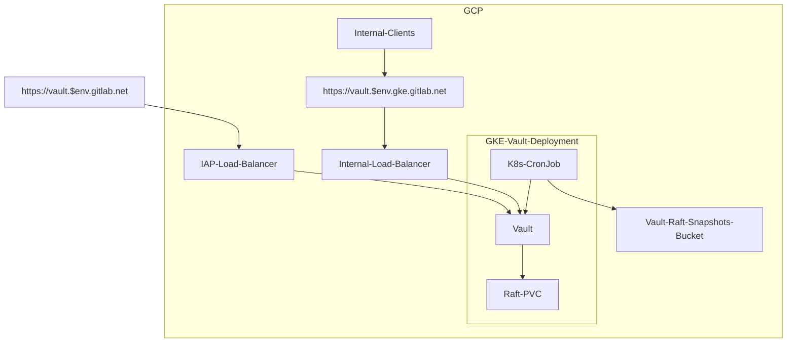
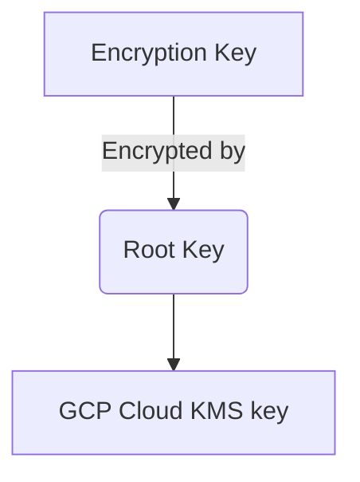

# Vault Secrets Management

## Summary

Vault is an identity-based secret and encryption management system. It can be used as a central store to manage access and secrets across applications, systems, and infrastructure.

## Vault Environments

We currently have two specific Vault instances setup to provide secrets to our infrastructure.

* <https://vault.gitlab.net> for all environments using secrets
* <https://vault.pre.gitlab.net> for testing configuration/deployments

## Architecture

### High Level Overview



The application is deployed in Kubernetes using the official [Vault Helm chart](https://github.com/hashicorp/vault-helm) from Hashicorp.

* [Helm chart deployment](https://gitlab.com/gitlab-com/gl-infra/argocd/apps/-/tree/main/services/vault)
* Internal and external ingress (see [ingress section below](#ingress))

#### Availability

We run Vault in [High Availability mode](https://developer.hashicorp.com/vault/docs/concepts/ha). This consists of one active Vault server and several standby servers. Since we're using the community version, standby instances are not unsealed and are only replicating the data but are not able to read it, and they will forward all requests to the leader instance. The standby instances only unseal when being promoted to leader.

We have enabled [automatic unseal with GKMS](https://learn.hashicorp.com/tutorials/vault/autounseal-gcp-kms?in=vault/auto-unseal). The unsealing process is delegated to Google KMS in the event of a failure. The Vault cluster will coordinate leader elections and failovers internally.

We have configured 5 replicas with spread constraints for pods to be in [different hosts and be distributed in different zones](https://gitlab.com/gitlab-com/gl-infra/argocd/apps/-/blob/b25b54707ca3431dd697eaf810ed52a2cbc9cb6b/services/vault/values.yaml#L34-52), which gives us multi-zone failure tolerance across 3 different zones.

Raft storage is configured with regional SSD persistent disks which provide durable storage and replication of data between three zones in the same region.

Additionally, we have multi-region backups we can restore as disaster recovery (in case of full region failure) (see [storage section below](#storage)).

In short, we have redundancy across zones in the `us-east1` region, but not across different regions. However we are able to easily and rapidly restore the service in a different region when needed.

##### Raft autopilot

Vault's [Raft autopilot](https://developer.hashicorp.com/vault/docs/concepts/integrated-storage/autopilot) is configured in [`environments/vault-production/vault_config.tf`](https://ops.gitlab.net/gitlab-com/gl-infra/config-mgmt/-/blob/f676e07591aa7441a04928f90ccbcb9f537286f5/environments/vault-production/vault_config.tf#L77-84):

```terraform
resource "vault_raft_autopilot" "autopilot" {
  cleanup_dead_servers               = true
  dead_server_last_contact_threshold = "12h0m0s"
  last_contact_threshold             = "10s"
  max_trailing_logs                  = 1000
  min_quorum                         = 3
  server_stabilization_time          = "10s"
}
```

Autopilot automatically prunes dead peers 12 hours after last contact and requires a stabilization period before a new server is promoted to voter. Combined with the [`vault-pvc-rotater`](#vault-pvc-rotater) CronJob this ensures nodes are recycled cleanly on a regular basis.

#### Ingress

We have one internal and one external endpoint, keeping the service from being directly exposed to the internet.

* External ingress for web user access is accessible through a GCP HTTPS load balancer that uses Google Identity-Aware Proxy
(IAP). It can be accessed through `https://vault.gitlab.net` (production) and `https://vault.pre.gitlab.net` (preprod).
  * Note: Vault CLI does not work through this load balancer at the time of this writing, see [this feature request](https://github.com/hashicorp/vault/issues/4982).
* Internal ingress for CI/Kubernetes/Terraform/Chef/Ansible/etc (API) is exposed through a Kubernetes service with a zonal network endpoint group (NEG) as a backend. The Vault service uses the default port `8200` which is then exposed on port `443` by the ingress. It can be access through `https://vault.ops.gke.gitlab.net` (production) and `https://vault.pre.gke.gitlab.net` (preprod).
  * Prometheus metrics are gathered from the endpoint `/v1/sys/metrics` on that same port.

#### Storage

Vault's Integrated Storage engine [Raft](https://developer.hashicorp.com/vault/docs/concepts/integrated-storage) is used for storage. This allows all the nodes in a Vault cluster to have a replicated copy of Vault's data locally. It is also used as the HA backend.


[Source](https://learn.hashicorp.com/tutorials/vault/raft-storage?in=vault/raft)

We are not using the enterprise version for Vault which come with automatic backups. Instead we are running a [Kubernetes CronJob](https://gitlab.com/gitlab-com/gl-infra/argocd/apps/-/blob/b25b54707ca3431dd697eaf810ed52a2cbc9cb6b/services/vault/values-extras.yaml#L65) to create and save raft snapshots to a GCS bucket every hour. Manual testing was done in the `pre` environment for validation, snapshot backup, and restoration.

Snapshot backups are saved [across multiple regions in the United States](https://ops.gitlab.net/gitlab-com/gl-infra/config-mgmt/-/blob/f676e07591aa7441a04928f90ccbcb9f537286f5/modules/vault-project/variables.tf#L22-26) and can be used for region failure disaster recovery.

#### Resources and Configuration

Vault is configured across several Terraform modules and environments, each with a well-defined scope. The table below summarises what each piece owns.

| Layer | Location | Owns |
| --- | --- | --- |
| GCP scaffold | [`config-mgmt/modules/vault-project`](https://ops.gitlab.net/gitlab-com/gl-infra/config-mgmt/-/blob/main/modules/vault-project) | KMS keyring and unseal key (auto-unseal), the Raft snapshots GCS bucket and its IAM bindings. Deployed in the dedicated `gitlab-vault-<env>` GCP projects. |
| Cluster-side GCP resources | [`config-mgmt/modules/vault`](https://ops.gitlab.net/gitlab-com/gl-infra/config-mgmt/-/blob/main/modules/vault) | IAM bindings and service accounts used by the Vault Kubernetes workload in the `gitlab-ops` and `gitlab-pre` projects. |
| Cluster-wide Vault configuration | [`terraform-modules/vault/vault-configuration`](https://ops.gitlab.net/gitlab-com/gl-infra/terraform-modules/vault/vault-configuration) | All authentication methods (Okta OIDC, GCP, Kubernetes, JWT per GitLab instance, AppRole for the single `vault-provisioning` role used to bootstrap the environment), all KV/PKI/Transit/GCP/Kubernetes secrets engines, admin and user OIDC roles, shared policies, audit sink, identity-entities-cleaner role. |
| Environment wiring | [`config-mgmt/environments/vault-production`](https://ops.gitlab.net/gitlab-com/gl-infra/config-mgmt/-/blob/main/environments/vault-production) / [`vault-staging`](https://ops.gitlab.net/gitlab-com/gl-infra/config-mgmt/-/blob/main/environments/vault-staging) | Instantiates the `vault-configuration` module and owns Okta group membership ([`groups.tf`](https://ops.gitlab.net/gitlab-com/gl-infra/config-mgmt/-/blob/main/environments/vault-production/groups.tf)), secret policies ([`secrets_policies.tf`](https://ops.gitlab.net/gitlab-com/gl-infra/config-mgmt/-/blob/main/environments/vault-production/secrets_policies.tf)), GCP projects and rolesets ([`gcp.tf`](https://ops.gitlab.net/gitlab-com/gl-infra/config-mgmt/-/blob/main/environments/vault-production/gcp.tf), [`gcp_projects.tf`](https://ops.gitlab.net/gitlab-com/gl-infra/config-mgmt/-/blob/main/environments/vault-production/gcp_projects.tf)), Kubernetes cluster registration ([`kubernetes.tf`](https://ops.gitlab.net/gitlab-com/gl-infra/config-mgmt/-/blob/main/environments/vault-production/kubernetes.tf)), Chef environments ([`chef.tf`](https://ops.gitlab.net/gitlab-com/gl-infra/config-mgmt/-/blob/main/environments/vault-production/chef.tf)), and the Raft autopilot resource ([`vault_config.tf`](https://ops.gitlab.net/gitlab-com/gl-infra/config-mgmt/-/blob/main/environments/vault-production/vault_config.tf)). |
| Cluster-side wiring | [`config-mgmt/environments/pre/vault.tf`](https://ops.gitlab.net/gitlab-com/gl-infra/config-mgmt/-/blob/main/environments/pre/vault.tf) / [`ops/vault.tf`](https://ops.gitlab.net/gitlab-com/gl-infra/config-mgmt/-/blob/main/environments/ops/vault.tf) | Instantiates the `modules/vault` module in the `pre` and `ops` environments (i.e. the GCP projects hosting the Vault Kubernetes workload). |
| Per-project Vault resources | [`terraform-modules/gitlab/project`](https://ops.gitlab.net/gitlab-com/gl-infra/terraform-modules/gitlab/project) — [`vault.tf`](https://ops.gitlab.net/gitlab-com/gl-infra/terraform-modules/gitlab/project/-/blob/main/vault.tf), [`vault_policies.tf`](https://ops.gitlab.net/gitlab-com/gl-infra/terraform-modules/gitlab/project/-/blob/main/vault_policies.tf), [`vault_transit_key.tf`](https://ops.gitlab.net/gitlab-com/gl-infra/terraform-modules/gitlab/project/-/blob/main/vault_transit_key.tf) | Per-project JWT roles (readonly, protected read-write, per-environment ro/rw), matching policies, transit key, and the per-project CI variables (`VAULT_AUTH_ROLE`, `VAULT_AUTH_ROLE_SUFFIX`, `VAULT_SECRETS_PATH`, `VAULT_TRANSIT_KEY_NAME`, plus per-environment variants). |
| Group-level CI variables | [`terraform-modules/gitlab/group//modules/vault-variables`](https://ops.gitlab.net/gitlab-com/gl-infra/terraform-modules/gitlab/group/-/blob/main/modules/vault-variables/group_variables.tf) | Group-level GitLab CI variables: `VAULT_ADDR`, `VAULT_SERVER_URL`, `VAULT_AUTH_PATH`, `VAULT_SECRETS_SHARED_PATH`, `VAULT_TRANSIT_PATH`. |

#### Maintenance automation

Some Kubernetes cron jobs have been setup to help with regular maintenance of the Vault cluster:

##### `vault-identity-entities-cleaner`

* Cronjob definition: <https://gitlab.com/gitlab-com/gl-infra/argocd/apps/-/blob/b25b54707ca3431dd697eaf810ed52a2cbc9cb6b/services/vault/values-extras.yaml#L223>
* Container image: <https://gitlab.com/gitlab-com/gl-infra/ci-images/-/tree/master/vault-identity-entities-cleaner>
* Script: <https://gitlab.com/gitlab-com/gl-infra/ci-images/-/blob/master/vault-identity-entities-cleaner/scripts/cleaner.rb>

Vault creates an [identity entities](https://developer.hashicorp.com/vault/docs/concepts/identity#entities-and-aliases) for each user authenticating into it, which includes humans via OIDC, Kubernetes service accounts and GitLab CI jobs authenticating via JWT. In particular, each CI job has its own unique identity based on their job ID claim, that are then never used again (unless the job is retried later). Vault currently doesn't have any mechanism to automatically cleanup old unused identities so they keep accumulating indefinitely, filling the storage, causing high memory usage and degrading performances (see [this issue](https://github.com/hashicorp/vault/issues/8761)).

This job remediates this problem by deleting in small batches all identity entities that are older than 7 days (max TTL for OIDC logins) every hour, keeping the storage size under control.

##### `vault-pvc-rotater`

* Cronjob definition: <https://gitlab.com/gitlab-com/gl-infra/argocd/apps/-/blob/b25b54707ca3431dd697eaf810ed52a2cbc9cb6b/services/vault/values-extras.yaml#L156>

Vault uses a BoltDB database as its Raft logs storage, which cannot shrink to recover space when data is deleted. Although it tries to reuse old pages when possible, the database file inevitably keeps growing indefinitely (see [BoltDB Raft logs](https://developer.hashicorp.com/vault/docs/internals/integrated-storage#boltdb-raft-logs)). This eventually leads to memory pressure and/or OOM events as the database file is loaded into memory as page cache which increases memory usage as the file keeps growing.

This job remediates this problem by deleting the oldest Persistent Volume Claim and rotating its attached pod once a week, so that the node bootstraps itself with a fresh Raft snapshot. This also serves as a chaos monkey ensuring that automatic Vault node recovery keeps working properly.

### Upgrades

Vault upgrades come as two independent Renovate MR streams:

* **Vault container image bumps** via the pinned `image.tag` in [`services/vault/values.yaml`](https://gitlab.com/gitlab-com/gl-infra/argocd/apps/-/blob/main/services/vault/values.yaml). This is the one that actually changes the Vault server version.
* **Helm chart version bumps** on the [Vault Helm chart](https://github.com/hashicorp/vault-helm) in [`services/vault`](https://gitlab.com/gitlab-com/gl-infra/argocd/apps/-/tree/main/services/vault). Because `image.tag` is pinned in our values, chart bumps never change the Vault version by themselves; they only bring template and default changes.

Before merging, check the relevant changelog for breaking changes:

* Image bumps → [Vault changelog](https://github.com/hashicorp/vault/blob/main/CHANGELOG.md)
* Chart bumps → [Helm chart changelog](https://github.com/hashicorp/vault-helm/blob/main/CHANGELOG.md)

Breaking changes may require additional work in:

* the Helm chart values at [`services/vault/values.yaml`](https://gitlab.com/gitlab-com/gl-infra/argocd/apps/-/blob/main/services/vault/values.yaml) (new config knobs, deprecated fields)
* the [`terraform-modules/vault/vault-configuration`](https://ops.gitlab.net/gitlab-com/gl-infra/terraform-modules/vault/vault-configuration) module (auth methods, secrets engines, policies)

Once merged, ArgoCD applies the manifest and the Vault StatefulSet rolls pods one at a time. Watch the rollout with `kubectl -n vault rollout status sts/vault` and confirm each pod rejoins Raft as a follower (`vault operator raft list-peers`) before the next pod is replaced. Also monitor the cluster status row at the top of the [Vault service dashboard](https://dashboards.gitlab.net/d/vault-main/vault-overview) and watch for any `VaultLowFailureTolerance` alerts firing in `#f_fleet_alerts` during the rollout.

### Authentication

#### User authentication

We're using [Google Identity-Aware Proxy](https://docs.cloud.google.com/iap/docs/concepts-overview) for the external load balancer and [Okta OIDC](https://developer.hashicorp.com/vault/docs/auth/jwt/oidc-providers/okta) is required to log into the Vault web interface.

#### API authentication

* CI runners can be authenticated with [JWT](https://developer.hashicorp.com/vault/docs/auth/jwt) using [JWKS](https://docs.gitlab.com/ci/secrets/#configure-your-vault-server)
* GCP servers (chef client, ansible, etc) can be authenticated with [Google Cloud auth](https://developer.hashicorp.com/vault/docs/auth/gcp) (service accounts or instance service accounts)
* Kubernetes can be authenticated with [Kubernetes Service Account Tokens](https://developer.hashicorp.com/vault/docs/auth/kubernetes)

[Identities/Roles](https://developer.hashicorp.com/vault/docs/concepts/identity) and [Policies](https://developer.hashicorp.com/vault/docs/concepts/policies) are used to enforce RBAC and limit scope of access to necessary secrets. See the [Secret Access](#secret-access) section for more information.

## Security Considerations

### Data Encryption and Unsealing

Vault data is encrypted at all times. When Vault is started, it is always started in a sealed state and will not be able to decrypt data until it is unsealed.

To [unseal](https://developer.hashicorp.com/vault/docs/concepts/seal) Vault, a root key is needed to decrypt the Vault data encryption key.

To ensure that the root key is never known or leaked, we have configured auto-unseal using [`GCP KMS`](https://developer.hashicorp.com/vault/docs/configuration/seal/gcpckms) which lets us leverage GCP KMS to encrypt and decrypt the root key. Only the KMS key is able to decrypt the root key in our configuration. There is no other method possible to decrypt the root key. The Terraform configuration can [be found here](https://ops.gitlab.net/gitlab-com/gl-infra/config-mgmt/-/blob/main/modules/vault-project/kms.tf).



For better security access control, the KMS key is hosted in a separated GCP project:

* Production: [`gitlab-vault-production`](https://console.cloud.google.com/security/kms/keyring/manage/global/gitlab-vault-vault-production/key?project=gitlab-vault-production)
* Staging: [`gitlab-vault-staging`](https://console.cloud.google.com/security/kms/keyring/manage/global/gitlab-vault-vault-staging/key?project=gitlab-vault-staging)

### Recovery keys

Vault uses an algorithm known as [Shamir's Secret Sharing](https://en.wikipedia.org/wiki/Shamir%27s_Secret_Sharing) to split the recovery key into shards. It is important to know that the recovery key can **only** used to generate a root token but cannot be used to unseal Vault or decrypt any data.

Additionally, we're also using end-to-end TLS encryption for Vault.

### Secret Access

#### Role-based Access Control (RBAC) Policies

Vault uses policies to govern the behavior of clients and instrument Role-Based Access Control (RBAC). A policy defines a list of paths. Each path declares the capabilities (e.g. "create", "read", "update", "delete", "list", etc) that are allowed. Vault's denies capabilities by default unless explicitly stated other wise.

There are some [built in policies](https://developer.hashicorp.com/vault/docs/concepts/policies#built-in-policies) generated by Vault and we've currently configured the following policies (all in [`terraform-modules/vault/vault-configuration`](https://ops.gitlab.net/gitlab-com/gl-infra/terraform-modules/vault/vault-configuration)):

* [General usage policies](https://ops.gitlab.net/gitlab-com/gl-infra/terraform-modules/vault/vault-configuration/-/blob/main/policies.tf)
* [Terraform policies](https://ops.gitlab.net/gitlab-com/gl-infra/terraform-modules/vault/vault-configuration/-/blob/main/policies_terraform.tf)
* [GCP secrets engine policies](https://ops.gitlab.net/gitlab-com/gl-infra/terraform-modules/vault/vault-configuration/-/blob/main/policies_gcp.tf)
* [Kubernetes secrets engine policies](https://ops.gitlab.net/gitlab-com/gl-infra/terraform-modules/vault/vault-configuration/-/blob/main/policies_kubernetes.tf)
* Per-KV-mount policies:
  * `ci`: [`policies_kv_gitlab.tf`](https://ops.gitlab.net/gitlab-com/gl-infra/terraform-modules/vault/vault-configuration/-/blob/main/policies_kv_gitlab.tf) (shared) and [`policies_kv_gitlab_ci_identity.tf`](https://ops.gitlab.net/gitlab-com/gl-infra/terraform-modules/vault/vault-configuration/-/blob/main/policies_kv_gitlab_ci_identity.tf) (per-identity)
  * `k8s`: [`policies_kv_kubernetes.tf`](https://ops.gitlab.net/gitlab-com/gl-infra/terraform-modules/vault/vault-configuration/-/blob/main/policies_kv_kubernetes.tf) and [`policies_kv_kubernetes_identity.tf`](https://ops.gitlab.net/gitlab-com/gl-infra/terraform-modules/vault/vault-configuration/-/blob/main/policies_kv_kubernetes_identity.tf)
  * `chef`: [`policies_kv_chef.tf`](https://ops.gitlab.net/gitlab-com/gl-infra/terraform-modules/vault/vault-configuration/-/blob/main/policies_kv_chef.tf) and [`policies_kv_chef_identity.tf`](https://ops.gitlab.net/gitlab-com/gl-infra/terraform-modules/vault/vault-configuration/-/blob/main/policies_kv_chef_identity.tf)
  * `runway`: [`policies_kv_runway.tf`](https://ops.gitlab.net/gitlab-com/gl-infra/terraform-modules/vault/vault-configuration/-/blob/main/policies_kv_runway.tf) and [`policies_kv_runway_identity.tf`](https://ops.gitlab.net/gitlab-com/gl-infra/terraform-modules/vault/vault-configuration/-/blob/main/policies_kv_runway_identity.tf)
  * `shared`: [`policies_kv_shared.tf`](https://ops.gitlab.net/gitlab-com/gl-infra/terraform-modules/vault/vault-configuration/-/blob/main/policies_kv_shared.tf) and [`policies_kv_shared_identity.tf`](https://ops.gitlab.net/gitlab-com/gl-infra/terraform-modules/vault/vault-configuration/-/blob/main/policies_kv_shared_identity.tf)
  * `observability`: [`policies_kv_observability.tf`](https://ops.gitlab.net/gitlab-com/gl-infra/terraform-modules/vault/vault-configuration/-/blob/main/policies_kv_observability.tf) and [`policies_kv_observability_identity.tf`](https://ops.gitlab.net/gitlab-com/gl-infra/terraform-modules/vault/vault-configuration/-/blob/main/policies_kv_observability_identity.tf)

For each KV mount, the paired `_identity.tf` file generates per-identity (per-Okta-group, per-project, per-cluster) policies, while the base file defines the cluster-wide policies shared across all consumers of the mount.

#### JWT Authentication and Bound Claims

The JSON Web Token (JWT) method can be used to authenticate with Vault by a JWT authentication method or an OIDC. These JWTs can contain claims or a key/value pair. These can be used by Vault to validate that any configured "bound" parameters match which provide more granularity to authentication permissions.

For an example, see the [bound claims](https://ops.gitlab.net/gitlab-com/gl-infra/terraform-modules/vault/vault-configuration/-/blob/74303e87081d839dc5be19221da7a728ecd3350d/roles_oidc.tf#L44-46) configured for OIDC users based on Okta group memberships.

More details and specifications can be found in [the Vault documentation](https://developer.hashicorp.com/vault/docs/auth/jwt#bound-claims).

## Observability

### Prometheus / Mimir

Vault is monitored via Prometheus in GKE. Configuration is done through a [`ServiceMonitor`](https://gitlab.com/gitlab-com/gl-infra/argocd/apps/-/blob/b25b54707ca3431dd697eaf810ed52a2cbc9cb6b/services/vault/values.yaml#L154) which scrapes the `/v1/sys/metrics` endpoint. Our GKE prometheus metrics are also accessible in our Mimir cluster ([example metric](https://dashboards.gitlab.net/goto/bfgjxa4yub474f?orgId=1)).

A [service overview dashboard](https://dashboards.gitlab.net/d/vault-main/vault-overview) can be found in Grafana.

### Logs

We've configured audit logging to output to STDOUT which forwards logs to Kibana. The Vault logs can be viewed [here](https://nonprod-log.gitlab.net/goto/bf582b40-097a-11ed-af31-918941b0065a).

## Administration

See [Vault Administration](administration.md).

## Usage

See [How to use Vault for Secrets Management in Infrastructure](usage.md).

## Troubleshooting

See [Troubleshooting Hashicorp Vault](troubleshooting.md).
